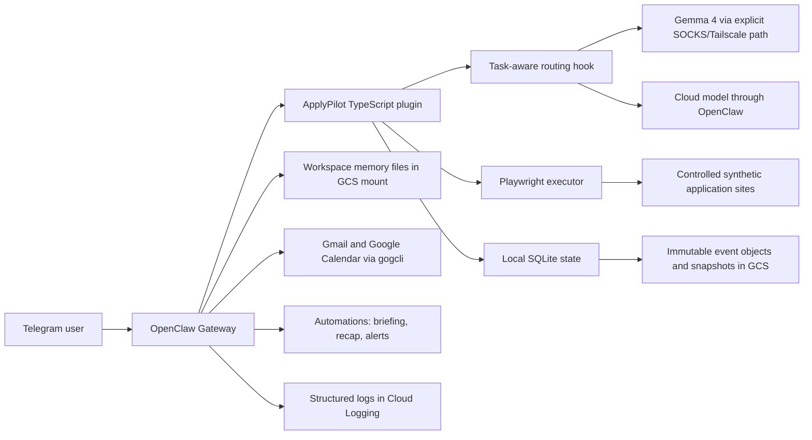

# ApplyPilot — Assignment 3 Engineering Plan

## Summary

Build ApplyPilot on **OpenClaw**, with TypeScript/Node.js, as a controlled job-application agent and a proactive personal assistant. The first product milestone is the requested end-to-end application workflow: synthetic candidate → controlled job URL → eligibility → grounded preparation → browser fill → independent verification → human approval → test-site submission → confirmed record.

Assignment 3 adds mandatory work beyond that product slice: a cloud-run OpenClaw deployment, local Gemma 4 over Tailscale, task-aware hybrid routing, at least four working skills, proactive features, durable memory, a 48-hour operational window, performance and security reports, grader access, and the required evidence package. The plan includes those requirements rather than treating them as optional polish.

The five assignment documents reviewed are [Assignment Description](<./Assignment_3_Description.pdf>), [Setup Recommendations](<./Assignment_3_Setup_Recommendations.pdf>), [Deployment Reference](<./Deployment_Reference.pdf>), [Local Gemma and Grader Access](<./Assignment3_local_Gemma.pdf>), and [Video Instructions](<./Assignment3_Video_Instructions.pdf>).

The eight class lecture decks reviewed are [SDK Landscape](<./Lecture_15_SDK_Landscape_v4.pdf>), [Architecture Deep Dive](<./Lecture_16_Architecture_Deep_Dive_v2.pdf>), [Agent Security](<./Lecture_17_Agent_Security.pdf>), [Measurement](<./Lecture_18_Measurement.pdf>), [JSON-RPC and MCP Transport](<./Lecture_19_JSON_RPC_MCP_Transport.pdf>), [WebSockets, Streaming, and A2A](<./Lecture_20_WebSockets_LLM_Streaming_A2A_v2.pdf>), [Computer Use](<./Lecture_21_computer_use_capability.pdf>), and [Autonomous Orchestration](<./Lecture_22_loops_autonomous_orchestration.pdf>). Their relevant rules are translated into design decisions below; they do not supersede the assignment rubric.

**Compulsory assignment items** are identified below. Setup recommendations and the infrastructure reference are guidance unless the Assignment Description or rubric makes the item mandatory. The plan chooses the ClawHub publication option for the advanced integration criterion; it does not attempt A2A or three-platform messaging.

## 1. Requirements analysis and compliance

| Compulsory requirement | Planned implementation | Verification and evidence |
|---|---|---|
| OpenClaw platform; cloud model plus local Gemma 4 through Ollama | OpenClaw Gateway on Google Cloud Run **Instances**; a supported cloud model through OpenClaw; Gemma 4 on the laptop | Deployed version/model logs; demo shows both models actually answering |
| Task-aware hybrid routing with reason and outcome logs | OpenClaw TypeScript plugin using `before_model_resolve`; deterministic routing policy and structured routing events | Three or more task-type comparisons; local/cloud demonstration; reversible rate-limit simulation; Cloud Logging query |
| Tailscale connection from Cloud Run Instance to laptop Ollama | Userspace Tailscale in the container; Ollama stays on laptop loopback and is reached through Tailscale Serve and an explicitly configured proxy path | Cloud-originated `/api/tags` and completed inference; laptop LAN access test fails; routing log identifies Gemma |
| Telegram or Discord; at least four working skills | Telegram; separate `calendar`, `email`, `web-search`, and `applypilot` skills | Exercise all four in the deployed agent and capture them in logs/demo |
| At least four of the six advanced features | Implement all six: morning briefing, end-of-day recap, email integration, proactive alerts, calendar intelligence, and synthetic personal knowledge base | Scheduled delivery and event-trigger evidence; demo includes briefing, recap, and an alert |
| Persistent memory across sessions and restarts; scheduling | OpenClaw workspace files plus application memory; built-in Automations/cron; Cloud Storage-backed durability | Restart-and-recall test, scheduled run history, stored configuration and logs |
| Container isolation and at least one additional security measure | Non-root container with reduced capabilities and restricted tools; code-enforced approval gates and input defenses | Container configuration, timestamped startup isolation report, `openclaw security audit --deep`, security audit document |
| Human approval for every email send; no unattended approved actions | Draft-only scheduled workflows; explicit human approval and recipient allowlist at the send boundary | Attempted send is blocked without approval; scheduled job produces draft/notification only |
| Dedicated temporary email and calendar; synthetic data only | Dedicated temporary accounts and synthetic recruiter mail, events, profiles, and jobs | Redacted account/config evidence; no personal or USC inbox/calendar connected |
| Correct Google Cloud deployment, durable bucket, 48 hours of operation | Cloud Run Instance in a currently supported region; Cloud Storage bucket; logs spanning the full 48-hour interval | Instance description, bucket configuration, full timestamp coverage, recovery/restart evidence |
| Performance comparison across cloud and local models | Same task set evaluated on cloud and Gemma; latency, quality, cost, routing correctness | Reproducible report with raw anonymized measurements and methodology |
| Grader access and all required deliverables | OpenClaw dashboard access via the assignment’s Tailscale sharing procedure; private credentials submitted through Brightspace | Test access before submission; named source, evidence, reports, process log, and video |
| Advanced integration criterion | Publish the student-created ApplyPilot skill to ClawHub at a pinned version | Public location, commit/version, and fresh OpenClaw install/run transcript |

The Advanced Integration rubric’s ClawHub option is the best fit for the ten-day schedule. The assignment text’s install-transcript sentence refers to a “fresh Hermes install” even though the selected option is OpenClaw/ClawHub. The defensible interpretation is to provide a transcript from a fresh pinned **OpenClaw** installation, and document that interpretation in the submission.

## 2. Technology decisions

**OpenClaw and versioning.** Pin OpenClaw **2026.11.2**, the current published release verified during Gate 1; this exceeds the assignment document's minimum of 2026.10.9. The setup guide also discusses an older 2026.7.1-2 reference image. Use Node **24.22.1** in development and the container: current plugin-development documentation requires Node 24.22.1+ or 26.12.1+, while this machine's system Node 26.10.0 is too old for plugin development. A side-by-side Node 24.22.1 runtime was installed and used for the isolated probe; do not change the system Node. OpenClaw plugin APIs are experimental, so pin the host and declared plugin compatibility and rerun compatibility checks on upgrades. The 2026.11.2 plugin SDK dependency tree reported 34 moderate and 4 high npm advisories in Gate 1; review its production/runtime exposure and document remaining findings before deployment. [Node requirements](https://docs.openclaw.ai/install/node), [plugin requirements](https://docs.openclaw.ai/plugins/building-plugins), [plugin documentation](https://docs.openclaw.ai/plugins/building-plugins)

**Cloud model and router.** Prefer the assignment-recommended OpenAI OAuth route through OpenClaw, using a model confirmed in the account’s live model list. The router can select OpenAI or Ollama through OpenClaw’s model-resolution hook; it need not implement a second OAuth client. If the account cannot authenticate or the selected model is unavailable, use NVIDIA NIM as the documented fallback, after verifying a real request. Do not copy or share refresh tokens between laptop and cloud logins. OpenClaw’s `before_model_resolve` can select a provider/model and replace the run’s fallback list; explicit empty fallbacks prevent a private task from silently switching models. [Prompt and model hooks](https://docs.openclaw.ai/plugins/hooks/prompt-and-session)

**Routing behavior.** Use deterministic tags and rules: short, low-risk tasks prefer Gemma; privacy-sensitive tasks prefer Gemma and are held if it is unavailable; deep reasoning or long-context work goes to cloud; non-private tasks may use cloud when local inference is unavailable. A reversible configuration flag simulates a cloud rate-limit condition and routes eligible work locally without spending provider quota. A non-bundled plugin using `before_model_resolve` requires `plugins.entries.<id>.hooks.allowConversationAccess: true`; grant this only to the router plugin, treat its prompt input as sensitive, and never log or persist the text. Use `fallbacksOverride: []` to prevent a private task from silently switching to cloud. Configure Ollama's native API with an explicit model and base URL (no `/v1`); local Ollama needs no real bearer credential, but OpenClaw may require the documented local marker or `OLLAMA_API_KEY` to register/discover the provider. Prove the effective model from session/Gateway status and actual model-call telemetry; an `llm_output` hook alone does not prove the final response succeeded. Log route, rule, selected and actually served model, request ID, latency, and success—never message text. The rule and fallback behavior must match the README and video. [Prompt/model hooks](https://docs.openclaw.ai/plugins/hooks/prompt-and-session), [plugin hook permissions](https://docs.openclaw.ai/plugins/hooks), [Ollama setup](https://docs.openclaw.ai/providers/ollama/setup)

**Browser execution.** Follow the structured-surface hierarchy: use a documented API or connector when it fully supports the task; otherwise use a plugin/tool interface; use DOM/accessibility-based browser automation for controlled UI-only application sites; reserve screenshot/computer-use interaction for gaps in structured access. OpenClaw’s managed browser provides an isolated Chrome profile, snapshots, ref-based actions, form actions, uploads, and browser guidance, and can handle exploratory navigation. For ApplyPilot’s high-risk controlled-application transaction, use a **Playwright-based executor** behind typed plugin tools: it can inspect field state, handle conditional and multi-step forms, detect validation errors, and verify the result independently. It is justified by the assignment’s controlled browser-form scenarios and the need for deterministic assertions, approval separation, and duplicate protection. Both the executor and any managed browser action must be limited by explicit controlled-origin policy; browser policy alone is not a complete network firewall. If a site requires CAPTCHA, inaccessible authorization, or an ambiguous action outside the supported flow, stop and hand off to a human. [Browser overview](https://docs.openclaw.ai/tools/browser), [browser actions](https://docs.openclaw.ai/tools/browser/agent-tools), [browser security](https://docs.openclaw.ai/tools/browser/security)

**Skills and integrations.** Use four distinct workspace skills: `calendar`, `email`, `web-search`, and `applypilot`. Reuse OpenClaw’s native web-search capability and the assignment-recommended `gogcli` path for dedicated Gmail and Google Calendar. Wrap email operations in narrow typed tools rather than granting the model an unrestricted mail CLI. Use OpenClaw Automations for schedules and its workspace Markdown memory files for persistent profile/context. [Skills](https://docs.openclaw.ai/tools/skills), [Automations](https://docs.openclaw.ai/cron-vs-heartbeat), [memory](https://docs.openclaw.ai/concepts/memory)

**Supporting implementation choices.** Use TypeScript, OpenClaw’s TypeBox-based tool definitions, Playwright, SQLite on local container storage, and Google Cloud Storage’s Node client for durable event/snapshot storage. Use Open-Meteo for the briefing’s weather section and a fixed demo city; no news feature is necessary. These are implementation choices, not assignment-mandated technologies.

### Course concepts and design rationale

Apply the lecture principles as engineering constraints:

- **Choose the control locus before the model or SDK (Lecture 15).** OpenClaw owns agent lifecycle, messaging, skills, scheduling, and model-provider integration. The small TypeScript plugin owns ApplyPilot policy and typed business tools. The model is replaceable; approval, eligibility, and submission controls remain deterministic application code.
- **Keep the system understandable and auditable (Lecture 16).** Reuse OpenClaw and established libraries, while keeping the custom transaction state machine and approval boundary small enough to inspect. Measure the cost of each added component against its operational and audit value.
- **Contain first, detect second (Lecture 17).** Enforce origin restrictions, tool permissions, credential scope, approval checks, resource ceilings, and network boundaries in runtime code and infrastructure. Prompt instructions and injection classifiers are supplementary defenses, never the authority boundary.
- **Use the simplest fitting protocol (Lectures 19–20).** Use native OpenClaw plugin/tool interfaces for in-process capabilities. If an independent tool service becomes necessary, use the official MCP SDK and its typed request/error contracts rather than hand-rolling JSON-RPC. Scheduled checks can use OpenClaw Automations and ordinary HTTPS/polling. Add WebSockets only if a demonstrated feature needs frequent bidirectional messages; A2A is unnecessary for this single-agent design. MCP connects agents to tools; A2A connects agents to agents.
- **Select the most structured supported interaction surface (Lecture 21).** Prefer a documented API or connector, then a plugin/MCP tool, then DOM/accessibility automation for controlled sites. Use screenshots/computer-use interaction only when the needed state cannot be accessed structurally. The synthetic application benchmark is deliberately browser-facing, so Playwright remains justified for controlled UI-only forms and independent DOM assertions. Do not use pixel automation as the default. RAG grounds knowledge; browser actions perform the transaction. Keep delegated autonomy explicit across goal, planning, execution, and oversight; hand off when any dimension exceeds the user's authorization or the system's verified capability.
- **Make loops bounded and stops accountable (Lecture 22).** Application execution follows observe → interpret → act → verify, with checkpointed state and explicit stop/escalation paths. Start with ceilings of 20 model turns, 40 browser actions, 10 minutes, and $0.50 estimated model spend per application attempt; tune from measurements. Two repeated no-progress state fingerprints trigger human review. Any uncertain submit stops for reconciliation and must not auto-retry. Measure cost per completed task, not just tokens per prompt.
- **Evaluate with converging evidence (Lecture 18).** Keep the benchmark definition explicit (dataset, threat model, scoring rule, and judge); report VACR with its denominator and uncertainty alongside safety, accuracy, recovery, latency, and cost metrics. Do not infer overall safety or capability from a single score or claim external benchmark results unless actually run.

The loop ceilings are initial operational safeguards, not assignment thresholds; record any changes, rationale, and measured effect. These principles should appear in implementation documentation and the demo/report where they materially affect behavior.

## 3. System architecture and functional design

The gateway hosts messaging, skills, and scheduling. The ApplyPilot plugin holds job-application business logic. The Playwright executor is the only component allowed to mutate controlled application pages. Cloud model and local Gemma routing are explicit and observable. Gmail, Calendar, weather, and search are supporting integrations; they do not control whether an application may be submitted.

### Data model and interfaces

Use validated TypeScript types with stable IDs and timestamps:

- **CandidateProfile:** synthetic identity; education, experience, skills, work authorization, location/preferences; verified fact IDs and source; multiple résumé artifact IDs with version and content hash.
- **Job:** ID, title, company label, location, URL, description, hard requirements, application origin, and extraction provenance.
- **EligibilityResult:** `eligible | ineligible | unknown`, hard-requirement outcomes, evidence references, and clarification questions.
- **Application:** job/profile/version references; status; detected form schema; prepared answers; verification report; approval record; submission attempt/idempotency key; independent confirmation.
- **ApplicationEvent:** append-only transition with actor, timestamp, correlation ID, prior/new state, and redacted result metadata.
- **RecruitmentEvent:** synthetic email/calendar event classification, related application, deadline, proposed action, and deduplication key.
- **RouteDecision:** request ID, `local | cloud | held`, rule, model expected/served, availability, latency, and success; no prompt or response content.

The plugin exposes narrow tools such as `discover_jobs`, `inspect_job_url`, `evaluate_eligibility`, `prepare_application`, `fill_application`, `verify_application`, `request_application_approval`, `submit_approved_application`, `track_application`, `summarize_recruitment_email`, and `draft_recruiter_reply`. Email send is a separate constrained capability.

Every application run is a bounded controller, not an open-ended agent loop. Each step records its checkpoint, observed state fingerprint, action, verification result, and remaining budgets. The controller stops on budget exhaustion, repeated no-progress/cycles, unsupported facts, unexpected origins, policy violations, or unresolved tool errors, then records a resumable `NEEDS_HUMAN` or `FAILED_SAFE` state. After interruption, it resumes from persisted state and re-observes the target before acting; it never assumes the last action succeeded.

### Application workflow and state

Application status progresses through:

`DISCOVERED → ELIGIBILITY_CHECKED → PREPARED → FILLED → VERIFIED → AWAITING_APPROVAL → APPROVED → SUBMITTING → SUBMITTED → CONFIRMED`

Any missing candidate fact, failed eligibility, unsupported question, validation issue, changed form, or uncertain submission moves to `NEEDS_HUMAN` or `FAILED_SAFE`. No LLM tool can jump directly to `APPROVED` or `CONFIRMED`.

1. Accept a controlled-site job URL or search the seeded synthetic job catalog. Parse job requirements and retain evidence.
2. Evaluate hard requirements against explicit candidate facts. `unknown` is not treated as eligible; ask for clarification or stop.
3. Select a résumé version and prepare answers with fact/source references. Unsupported answers are left blank or escalated.
4. Inspect the actual form, map fields and page steps, fill supported fields, upload the selected résumé, then re-inspect the form and errors.
5. Independently compare every field against the prepared answer and source facts. Store a verification report and page-state hash.
6. Present the human with the job, résumé version, answers, unresolved items, and verification summary.
7. On explicit approval from an authenticated allowlisted user, persist a one-use approval record bound to the verified application revision. Recheck the revision and eligibility immediately before submitting.
8. Persist `SUBMITTING` before the click. After interruption, inspect the controlled site’s submission record and confirmation state before any retry. The synthetic sites support an idempotency key so a retry cannot create a second application.
9. Confirm submission from the test site’s independent confirmation record and visible confirmation page, then persist `CONFIRMED`. A success-looking LLM response alone is never confirmation.

Direct URLs are accepted for inspection, but form mutation and submission are restricted to exact controlled evaluation origins. Real employer applications are out of scope.

### Recruitment and proactive workflows

- **Morning briefing:** scheduled Telegram message with synthetic-calendar events and gaps, weather for the fixed demo city, and summaries of unread/flagged test emails.
- **End-of-day recap:** actual recorded work, messages handled, pending approvals, and tomorrow’s schedule/deadlines.
- **Email intelligence:** classify synthetic confirmations, recruiter responses, assessments, interviews, rejections, and deadlines; associate to an application; draft replies. Send only through the explicit approval boundary.
- **Calendar intelligence:** detect conflicts and suggest slots; do not create or change events without approval.
- **Proactive alerts:** periodic cron checks against a durable email/calendar cursor for new deadlines and near-term interviews; deduplicate notifications. This is scheduled polling, not a sleep-loop.
- **Personal knowledge base:** synthetic preferences in `USER.md` and curated durable facts in `MEMORY.md`; never retain untrusted email/job instructions as trusted preferences.

## 4. Persistence, deployment, and security

**Google Cloud.** Deploy a containerized OpenClaw Gateway as a **Cloud Run Instance**, not a Cloud Run Service, in a region confirmed against Google’s current Instances list. Start at 1 vCPU and use 2 GiB if the measured OpenClaw/browser workload requires it; the assignment permits this and the setup material reports OpenClaw may exceed 1 GiB. Use a dedicated runtime service account, Artifact Registry, Secret Manager, Cloud Logging, and the required Cloud Storage bucket. [Cloud Run Instances locations](https://docs.cloud.google.com/run/docs/locations), [Instance creation](https://docs.cloud.google.com/run/docs/quickstarts/instances/create-instance)

**Durable state.** Mount Cloud Storage for the OpenClaw workspace files and synthetic profile memory, with restrictive ownership/modes and a single-writer policy. Keep OpenClaw’s SQLite state and ApplyPilot SQLite database on local disk; Cloud Storage FUSE is not POSIX-transactional and does not provide file locking. Write immutable state-transition objects to the bucket using generation preconditions before acknowledging critical transitions; periodically snapshot SQLite with its online backup API. On startup, restore the newest validated snapshot and replay later events idempotently. Test memory and application-state survival through an instance restart. [Cloud Storage mounts and limitations](https://docs.cloud.google.com/run/docs/configuring/instances/cloud-storage-volume-mounts)

**Tailscale and grader access.** Run Tailscale userspace networking in the container and explicitly direct only local Ollama traffic through its SOCKS5 proxy; do not assume global proxy variables affect Node clients. Keep Ollama bound to loopback and expose it to the tailnet using Tailscale Serve, not Funnel. Restrict tailnet grants so the agent reaches only laptop TCP 11434 and the grader reaches only agent HTTPS 443. For the OpenClaw grader link, persist the non-ephemeral Tailscale identity/state in the protected bucket so the shared URL survives restart; this follows the OpenClaw-specific grader-access instructions rather than the general Deployment Reference’s ephemeral-node example. Submit the Cloud Run Instance URL and Tailscale share link privately through Brightspace. [Tailscale Cloud Run guide](https://tailscale.com/docs/install/cloud/cloudrun)

**Security boundaries and threat model.** Containment is enforced before detection. Run as non-root, drop unnecessary Linux capabilities, avoid privileged mode, protect mounted state and secrets, restrict Telegram senders, and restrict available OpenClaw tools. Model-based classification and prompt-injection tests can detect suspicious content, but cannot grant authority or replace origin, tool, approval, and egress boundaries. Threats and mitigations:

1. **Prompt injection in jobs/emails:** treat external text as untrusted data; do not execute instructions from it; allowlist tools and origins; test at least three distinct attacks and record pass/fail.
2. **Unsupported candidate claims:** evidence-bound answers; unknown fields remain unanswered; verifier blocks unsupported values.
3. **Unauthorized or duplicate submission:** server-enforced one-time human approval bound to a revision; durable `SUBMITTING` transition; test-site idempotency key and post-submit reconciliation.
4. **Email exfiltration or unintended send:** dedicated synthetic mailbox; least-privilege scopes; recipient allowlist; send requires human approval in code; cron can only draft and notify.
5. **Browser SSRF or navigation to a real employer:** exact controlled-origin allowlist, redirect checks, and no external form mutation; use the OpenClaw browser’s SSRF policy as defense in depth.
6. **Leaked OAuth, bot, or Tailscale credentials:** Secret Manager; ignored local secret file; no secrets in images, logs, process log, screenshots, video, or ZIP.
7. **Compromised skill/plugin or excessive tools:** pin dependencies, inspect installed skills, restrict plugin/tool allowlists, run security audit, and do not grant arbitrary shell execution.
8. **Memory poisoning or concurrent writes:** provenance rules, serialized writes, append-only events, and restart/replay tests.
9. **Local model or network failure:** bounded connectivity checks; hold private tasks when local is unavailable; route non-private tasks to cloud; never claim local privacy if cloud fallback occurred.

## 5. Implementation roadmap — approximately 10 days

| Day | Work and dependency | Exit criteria |
|---|---|---|
| **1 — Local feasibility gates** | Pin OpenClaw/Node; validate plugin tool and `before_model_resolve` behavior, Gemma 4 E2B served context/tool call. Inspect local hardware before settling on model/context. | Real local inference and tool-call evidence; route hook can select local Gemma. Cloud model authentication, Tailscale Serve, and Cloud Run Instance startup remain required and move to Day 7. Do not commit to the 48-hour window yet. |
| **2 — Synthetic evaluation sites and contracts** | Define candidate/job/application/event schemas and state transitions. Build controlled single-page, multi-step, and dynamic conditional form fixtures with validation and confirmation behavior. | Fixtures expose ground truth, test IDs, idempotent submissions, and seeded synthetic profile/job data. |
| **3 — Eligibility and answer grounding** | Implement URL/job parsing for fixtures, eligibility rules, résumé selection, question extraction, evidence-bound answer preparation, and clarification/refusal cases. | Hard requirements map to explicit facts; unknowns cannot be treated as eligible or answered by invention. |
| **4 — Browser execution vertical slice** | Implement Playwright fill/upload/step navigation, dynamic fields, validation capture, independent field verification, and confirmation inspection. | Requested vertical slice works end-to-end on at least one site with no submission until approval. |
| **5 — Approval, idempotency, persistence** | Add authenticated approval command/action, one-use revision-bound approval, submission recovery, SQLite state, durable event objects, and restart replay. | Unauthorized submit denied; approved submit confirmed; interrupted submit reconciles without duplication; state survives restart. |
| **6 — OpenClaw and assignment integration** | Package ApplyPilot tools/skills; configure Telegram, web search, calendar, email, profile files, and task-aware routing/logging. Add rate-limit simulation and local-unavailable behavior. | Four skills exercised; logs show decision and actual result without message text; privacy policy demonstrated. |
| **7 — Proactive features, security, deployment, preliminary soak** | Implement six advanced features; verify cloud-model authentication and inference; deploy Cloud Run Instance and bucket; establish Tailscale Serve/proxy path and stable grader access; configure secrets. Connect GCS immutable event/snapshot archival and replay to the locally verified SQLite store. Complete security tests and at least a preliminary soak. Confirm exact image, account scopes, cron timezone, memory limits, and evidence export. | Complete the cloud, GCS durability/replay, and Tailscale feasibility checks deferred from earlier gates, including cloud-originated Gemma inference and actual hybrid routing. All readiness checklist items pass before the formal 48-hour clock begins. |
| **8–10 — Formal 48-hour operation and closeout** | Start at a recorded UTC timestamp; monitor continuous service, scheduled jobs, new synthetic email/event alerts, model routes, persistence, restarts, and recovery. Do not change code/config during the window. After 48 hours, export logs and run evaluation/reporting. | Full timestamp coverage; no undocumented gaps; persistent state and scheduled work verified; reports and submission archive complete. |

The three-hour clean restart suggested in setup guidance is optional. Do not add it unless it passes a separate recovery/duplicate-job test before the observation window. If a managed restart occurs during the window, retain the incident, restore, and resumed-work evidence.

## 6. Testing and evaluation strategy

### Test layers

- **Unit:** eligibility rules; evidence-reference validation; route classifier; privacy classification; state-machine transitions; approval token expiry/replay; recipient allowlist; event deduplication; schema and redaction checks.
- **Integration:** OpenClaw plugin tool/hook contracts; local/cloud model routing; Cloud Storage object writes and replay; SQLite snapshot/restore; `gogcli` read/draft operations; Telegram allowlist and approval action; cron delivery.
- **Browser:** one-page, multi-step, and dynamic forms; dropdown/radio/checkbox/text fields; résumé upload; conditional field appearance; validation errors; stale DOM; navigation/interruption; confirmation; duplicate retry.
- **Failure injection:** local Ollama stopped/asleep; cloud rate-limit simulation; cloud model 404/timeout; Gmail or Calendar credential expiry; Tailscale path loss; browser crash; form validation failure; process termination before/after click; GCS write failure; restart during a scheduled job.
- **Security:** three or more distinct prompt-injection attempts embedded in job/email/form text; external-origin and redirect rejection; unauthorized submit and send denial; recipient denial; secret/log scan; tool allowlist and container isolation audit.

### Reproducible benchmark

Create a versioned dataset with multiple fictional profiles, résumé versions, job descriptions, and question variants. Use development data for tuning and held-out data for final reporting. Hold out form wording/order and conditional-field combinations. For every reported benchmark, state its dataset version, threat model, scoring rule, and judge (deterministic site ground truth or named human rubric); do not mix development examples into held-out results. Include distinct user-directed unsafe requests, environmental prompt injections in job/email/form content, and agent/tool misuse cases in the security evaluation, in addition to the required minimum injection examples.

- **Application evaluation:** at least 60 held-out eligible attempts balanced across the three site types, plus ineligible cases and cases requiring clarification/refusal. Record ground truth, approvals, submission record, confirmation evidence, and failures. The denominator for VACR is eligible attempted applications; non-eligible cases are reported separately.
- **Baselines:** (1) static browser automation with fixed field mapping and no adaptive reasoning; (2) basic LLM-powered OpenClaw browser agent with the same candidate and sites, but without ApplyPilot’s state machine, evidence verifier, and recovery controller. Run both against the same held-out tasks and safety gates.
- **Primary metric — VACR:** correctly completed, explicitly approved, successfully submitted, independently confirmed eligible attempts divided by eligible attempted applications. Report numerator, denominator, and confidence interval. Also report ineligible and clarification/refusal outcomes separately so a system cannot improve VACR by silently excluding difficult cases.
- **Supporting metrics:** field-level answer accuracy; unsupported/fabricated answer rate; end-to-end workflow success; human intervention rate; recovery success by injected failure; confirmation precision/recall; p50/p95 latency; cost per application.
- **Cloud/local comparison:** use the same 10-case set for each of at least three task types—short extraction, privacy-sensitive profile-grounded response, and reasoning-heavy eligibility analysis—on both models (60 model runs total). Human-score correctness/grounding with a fixed rubric, and record latency, token/usage cost where available, served model, and route appropriateness.
- **Targets, not claimed results:** VACR ≥90% on eligible held-out attempts; zero unsupported candidate facts submitted; zero unauthorized or duplicate submissions; 100% correct confirmation classification on the controlled sites; report all other metrics without hiding failures. Treat these as project acceptance targets, not proof of broader safety. Do not report benchmark results until measured, and do not substitute public safety benchmark scores for ApplyPilot-specific workflow evaluation.

## 7. Assignment conflicts, risks, and fallbacks

- **OpenClaw version conflict:** Setup Recommendations describe a 2026.7.1-2 Docker default and separate 2026.10.9 retesting; the Local Gemma document requires at least 2026.10.9. Gate 1 verified 2026.11.2, which exceeds the minimum; pin it with Node 24.22.1 and repeat configuration/plugin/deployment checks for any upgrade. The plugin SDK dependency tree had 34 moderate and 4 high npm audit findings; determine which affect runtime dependencies and include the remaining exposure in the security report.
- **Video length conflict:** Assignment Description requires a **5–7 minute MP4**; Local Gemma instructions estimate a **7–10 minute** recording, while Video Instructions require one single video but set no length. Follow the authoritative 5–7 minute submission limit. Rehearse the complete required sequence, warm Gemma before recording, and use concise captured schedule outputs while keeping all required model replies and route evidence visible. If the sequence cannot fit without omitting evidence, document the conflict and prioritize the Description’s limit.
- **Tailscale identity conflict:** general deployment guidance illustrates ephemeral nodes; OpenClaw grader-access instructions require a stable shared agent identity across restarts. Use persistent, protected non-ephemeral state for the OpenClaw grader endpoint.
- **Hybrid routing failure:** if OAuth login is blocked or model access is denied, switch to a verified NVIDIA NIM model. If laptop hardware cannot operate Gemma 4 with a full agent context, use the assignment’s documented cloud-only hardware accommodation and document the impact on hybrid-routing evidence; do not pretend the local path works.
- **GCS limitations:** avoid active SQLite on FUSE; use local SQLite plus durable events and snapshots. If FUSE mount startup is unreliable, keep required Cloud Storage access through the official client and verify that the required bucket is still durable and demonstrably used.
- **10-day scope risk:** freeze application support to the three controlled site families and synthetic data. Public job-board automation, real employer submission, and unrelated production integrations are excluded; direct arbitrary URLs are inspection-only unless they resolve to the controlled test origins.

## 8. Final deliverables checklist

- [ ] `firstname_lastname_a3.zip` with source, pinned dependencies/configuration, container/deployment files, skill sources, and `.env.example` placeholders only.
- [ ] Root README: setup/deploy, versions, chosen cloud model/auth, local Gemma/context, routing rules, privacy-unavailable policy, supported controlled origins, and grader access instructions.
- [ ] Synthetic `SOUL.md`, `USER.md`, `MEMORY.md`, and candidate profile/resume fixtures.
- [ ] Cloud Run Instance HTTPS URL, GCS persistence configuration, and timestamped logs covering the full 48 hours, including lifecycle/recovery and scheduled runs.
- [ ] Security audit: at least five risks, concrete mitigations, remaining risks, container isolation evidence, approval gates, recipient allowlist, and at least three documented prompt-injection attempts if that defense is claimed.
- [ ] Performance comparison report: reproducible dataset/method, cloud/local results for at least three task types, application baselines, VACR and supporting metrics, routing correctness, latency and cost; no invented results.
- [ ] Process log at repository root named `PROCESS_LOG.md`: every AI tool/model used, 200–300 word chronological narrative with material prompts, substantial AI-generated code attribution, verification narrative, and 2–3 sentences on what the tools could not determine.
- [ ] ApplyPilot skill published to ClawHub at a pinned version, with public location and fresh OpenClaw installation/run transcript; no credentials or candidate data in the published package.
- [ ] One 5–7 minute MP4 named `Assignment3-CSCI599-USCusername.mp4`, recorded as instructed: device identifier, deployed platform version, Gemma listing, four routed requests (local → cloud → private task with Gemma off → private task with Gemma on), routing logs without message text, `ollama ps`, messaging-app exchange, morning briefing, proactive alert, and end-of-day recap. No secrets on screen.
- [ ] Grader URL and required credentials/share link submitted privately through Brightspace, never committed or shown in the video.

## Assumptions and defaults

- Use OpenClaw 2026.11.2 (Gate 1 verified; assignment minimum 2026.10.9), Node 24.22.1, Telegram, OpenAI OAuth through OpenClaw when available, and NVIDIA NIM only as a verified fallback.
- Use Gemma 4 E2B as the initial laptop model; select a larger model only after checking available memory and full agent context.
- Use dedicated temporary Google email/calendar accounts and synthetic content exclusively.
- Use a fixed demo city for weather, all six advanced features, and ClawHub as the selected advanced-integration option.
- Keep browser mutation and submission limited to controlled test origins; never submit fictitious applications to real employers.

## Rubric alignment amendment — 2026-11-12

User authorized autonomous sequential execution of the remaining gates after the rubric review. Preserve the existing product scope, all six advanced features, ClawHub publication, application benchmarks, and Gate 9 cloud/Tailscale sequencing. Gate completion still requires actual evidence; no approval authorizes unattended application submission or email sending.

- §2.3 complexity floors are explicit assignment minima: four skills (calendar, email, web search, ApplyPilot), container isolation plus another security measure, at least four advanced features, workspace memory, scheduling, dedicated synthetic accounts/data, and 48-hour evidence.
- Prioritize restoring reproducible Gateway operation and authenticated messaging before further browser expansion. Finish each current gate before advancing; report checkpoints without repeatedly asking permission to continue.
- §2.4/§5 require morning briefing, evening recap, and an alert in every demo. Briefing acceptance includes calendar events AND gaps, live weather for a fictional demo location, and unread/flagged email one-line summaries. Use Open-Meteo; document provider/failure behavior. News remains optional and excluded.
- Email feature acceptance requires contextual summaries, urgent-message flagging, and drafts for review. Sending is optional in the assignment; retain our planned approved-send extension, but do not label its availability a compulsory rubric requirement. Never grant extra OAuth scopes automatically. Document narrow required scopes, code enforcement and recipient allowlist; test refresh and reauthorize near the operational window if required.
- Calendar intelligence includes conflict detection, task-appropriate free slots, AND meeting context grounded in prior synthetic emails/documents. An empty calendar response is connectivity evidence only.
- Replace generic workspace templates with fictional preferences and identity. Demonstrate preference learning and recall after session and instance restart; SQLite application history alone does not meet the personalization requirement.
- Private classification takes precedence over reasoning complexity. Private tasks stay local or held, with no cloud fallback. Compare models only on synthetic inputs explicitly permitted for cloud evaluation; test private routing separately without sending private-classified payloads to cloud.
- Keep the cloud primary route operational through supported platform authentication; implement task-aware local selection and a reversible cloud-rate-limit simulation. Evidence must identify actual served model, reason, outcome, latency and cost without raw prompts.
- Container isolation, least privilege, secure credentials, three distinct documented injection attacks when claiming that defense, and a five-risk audit remain deployment gates. A credential-pattern scan is limited evidence, not a complete secrets audit. Never deploy the temporary auth-none Gateway configuration.
- Formal 48 hours begin only after deployment readiness. Manual recovery after a crash does not demonstrate uninterrupted operation. Managed/planned restarts require explicit recovery, no lost/duplicate jobs, and timestamped evidence; scheduled three-hour restarts are a recommendation, not a mandatory feature.
- PROCESS_LOG.md must contain a 200–300 word chronological narrative plus AI tools/models, material prompts, file/module attribution, verification narrative and 2–3 sentences of student learning. The entire file need not be limited to 300 words. Do not fabricate the student's reflection.
- Correct stale status claims in README/checklists. Historical test results remain dated; test-authenticator approvals do not prove real human interaction. Controlled test submissions must be distinguished from prohibited real-employer submissions.
- Rubric weights: hybrid routing 20%; proactive features 15%; security 15%; skill utility 15%; memory/scheduling/48h 15%; code/docs/demo 10%; one advanced integration (ClawHub chosen) 10%. Application VACR targets and 60 held-out attempts are retained project targets, not rubric minima.
