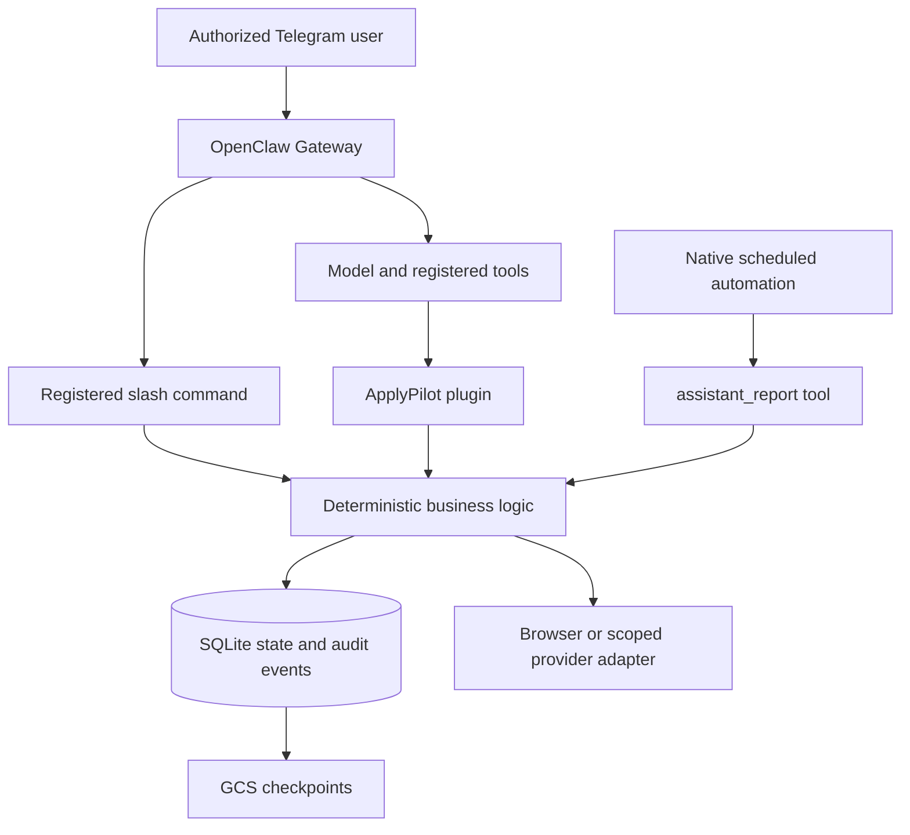

# ApplyPilot codebase walkthrough

This guide explains the source currently in this repository: where to start reading, how requests move through the system, and what each maintained file owns. It describes implemented behavior, not every capability proposed in the engineering plan. It is a source walkthrough, not a new deployment or benchmark report.

## 1. Start here: the system in plain English

ApplyPilot combines an **OpenClaw personal assistant** with a **controlled job-application workflow**. OpenClaw provides the conversation, model calls, Telegram connection, skill loading, and scheduled execution. Our TypeScript plugin provides application rules, browser execution, Google adapters, approval enforcement, and persistent records.

The model can choose a registered tool and propose arguments. It cannot approve its own application or bypass the submission rules. A separate authenticated command path handles human approval.

The main pieces are:

| Piece                       | Responsibility                                                    | Main location                                                                  |
| --------------------------- | ----------------------------------------------------------------- | ------------------------------------------------------------------------------ |
| OpenClaw host               | Conversations, model execution, messaging, scheduling             | Configured by `scripts/local-gateway.mjs`; installed through `deploy/runtime/` |
| ApplyPilot plugin           | Exposes narrow tools, commands, and model-routing hooks           | `src/plugin/src/`                                                              |
| Business logic              | Eligibility, preparation, approval, submission and recovery       | `src/applications/`, `src/policy/`                                             |
| Browser executor            | Operates and verifies the three controlled form families          | `src/browser/executor.ts`                                                      |
| Controlled employer website | Serves forms and authoritative submission records                 | `src/sites/`                                                                   |
| Personal assistant services | Email classification, calendar intelligence, briefings and alerts | `src/integrations/`, `src/scheduler/`                                          |
| Persistence                 | Transactional SQLite locally; durable archives in GCS             | `src/persistence/`                                                             |
| Cloud lifecycle             | Starts components, restores state, checks health, checkpoints     | `deploy/assistant-runtime.mjs`                                                 |

**There is no single `npm start` application entry point.** `src/index.ts` is only a project-name export. To understand actual startup, read the launcher and deployment entry point.

## 2. Recommended reading order

Follow this order before reading every implementation detail:

1. [README.md](README.md): setup and project overview. Then [IMPLEMENTATION_CHECKLIST.md](IMPLEMENTATION_CHECKLIST.md): evidence-backed progress and outstanding work.
2. [SKILLS.md](SKILLS.md), then [skills/applypilot/SKILL.md](skills/applypilot/SKILL.md): distinguish the functional contract from the instructions OpenClaw reads.
3. [src/contracts/domain.ts](src/contracts/domain.ts), then [src/fixtures/load.ts](src/fixtures/load.ts): learn the data shapes and where synthetic facts come from.
4. [src/policy/eligibility.ts](src/policy/eligibility.ts), then [src/applications/prepare.ts](src/applications/prepare.ts): follow facts into a prepared application.
5. [src/plugin/src/application-tools.ts](src/plugin/src/application-tools.ts), then [src/browser/executor.ts](src/browser/executor.ts): see how a tool call becomes browser work.
6. [src/sites/definitions.ts](src/sites/definitions.ts), then [src/sites/server.ts](src/sites/server.ts): understand the website the browser is operating.
7. [src/applications/lifecycle.ts](src/applications/lifecycle.ts), [src/persistence/application-store.ts](src/persistence/application-store.ts), [src/applications/approval.ts](src/applications/approval.ts), and [src/applications/submit.ts](src/applications/submit.ts): follow state, approval, submission, and recovery.
8. [src/plugin/src/application-commands.ts](src/plugin/src/application-commands.ts): find the human approval entry point. Then read [src/plugin/src/index.ts](src/plugin/src/index.ts) to see registration and schemas.
9. [src/scheduler/reports.ts](src/scheduler/reports.ts), then the email/calendar adapters: understand the personal assistant features.
10. [src/router/policy.ts](src/router/policy.ts), then [src/plugin/src/router-hooks.ts](src/plugin/src/router-hooks.ts): understand hybrid model routing.
11. [scripts/local-gateway.mjs](scripts/local-gateway.mjs), then [deploy/assistant-runtime.mjs](deploy/assistant-runtime.mjs): understand runtime assembly and cloud startup.
12. Read the test beside the module you want to change. Use [DEV_LOG.md](DEV_LOG.md) and `evidence/` to distinguish intended behavior, tested behavior, failures, and historical deployment results.

The large plugin `index.ts` is easier to understand after the domain modules. Start near its registration section, identify a tool, then trace its handler upward into the imported implementation.

## 3. Startup: what runs first?

### Local development

```text
scripts/local-gateway.mjs
  → reads configuration and prepares an OpenClaw workspace
  → copies initial identity/memory/skill files when needed
  → configures plugin, tools, agents, Telegram and model providers
  → starts OpenClaw (unless called with --prepare)

npm run sites:serve
  → src/sites/cli.ts
  → src/sites/server.ts
  → controlled job pages, application forms and submission records
```

These are separate processes. The launcher configures the assistant; the sites command starts the fictional employer website. The plugin is compiled using its own package configuration. Existing runtime workspaces are persistent: changing a root workspace template does not automatically overwrite an existing live workspace.

### Cloud container

```text
 deploy/Dockerfile
   → deploy/assistant-runtime.mjs
     → restore encrypted native state and application/site checkpoints
     → initialize connectivity and fixed Ollama proxy
     → prepare workspace/configuration with scripts/local-gateway.mjs
     → start controlled website and OpenClaw Gateway
     → wait for readiness, install scheduled jobs, run smoke checks
     → checkpoint durable state and expose health/readiness
```

`connectivity-probe.mjs` owns the userspace Tailscale connection and cloud-to-laptop inference checks. `ollama-proxy.mjs` exposes a narrow loopback endpoint to OpenClaw and forwards approved Ollama requests through the SOCKS route. This avoids relying on the Node HTTP client to honor a global proxy variable.

The deployment target is a Cloud Run **Instance**. SQLite runs on local disk; GCS stores snapshots and immutable archive objects. It is not a mounted SQLite filesystem.

Source and deployed images can differ. At the time this walkthrough was prepared, the startup wait/telemetry adjustment in `assistant-runtime.mjs` had not been rolled into the previously recorded manual-testing image. Consult image digests and timestamps in the deployment evidence before making claims about live behavior.

## 4. Three request paths



### A. Natural-language request

Telegram → OpenClaw agent → routing hook → eligible local/cloud model → registered tool → runtime validation → business logic → result → model reply.

The model can call tools such as `inspect_job_url`, `evaluate_eligibility`, `prepare_application`, `fill_application`, email/calendar readers, and `assistant_report`. Registration and schemas live in the plugin `index.ts`. Web search comes from the configured search provider; it is not the application fixture search.

### B. Deterministic command

Telegram → authenticated command handler → business logic → persisted result → response.

Application approval, email approval, and commands such as `/briefing` use this route. These actions do not need a model to decide how to execute their command grammar. Sender authentication and allowlists are checked in code. The model is not exposed to a general “submit anything” or “send arbitrary email” tool.

### C. Scheduled execution

OpenClaw native automation → `automation/*.code` → `assistant_report` → provider reads/state/deduplication → notification text → OpenClaw delivery.

The report generator prepares content. OpenClaw delivers it. A report being generated is not proof that Telegram delivered it; the code explicitly records delivery uncertainty in alert reservation state.

## 5. Follow one complete application

Use the ready fixture to understand the happy path: its job listing URL is `http://127.0.0.1:3210/jobs/platform-engineer-ready`. The form URL is a separate URL, such as `/apply/single-page`. These examples assume the local controlled site is running.

| Step                             | Go to this file                                                            | What happens                                                                                                                                        |
| -------------------------------- | -------------------------------------------------------------------------- | --------------------------------------------------------------------------------------------------------------------------------------------------- |
| 1. Load verified synthetic facts | `src/fixtures/load.ts`                                                     | Loads the candidate, jobs, résumé metadata and demo records; validates schemas and résumé integrity.                                                |
| 2. Resolve job URL               | `src/applications/job-url.ts`                                              | Enforces controlled origin and matches a known fixture listing. It does not scrape an arbitrary employer page.                                      |
| 3. Decide eligibility            | `src/policy/eligibility.ts`                                                | Evaluates structured hard requirements against candidate facts; produces eligible, ineligible or unknown with evidence.                             |
| 4. Prepare answers               | `src/applications/prepare.ts`                                              | Selects an unambiguous résumé and builds supported answers. Missing/unsupported facts require human attention.                                      |
| 5. Translate to a form           | `src/plugin/src/application-tools.ts`                                      | Maps prepared facts to the selected controlled form family, computes stable operation identity and invokes the executor.                            |
| 6. Fill and verify               | `src/browser/executor.ts`                                                  | Navigates known fields/steps, uploads the fixture résumé where applicable, reads values back, checks errors and prevents submission during filling. |
| 7. Save pending application      | `src/applications/lifecycle.ts` and `src/persistence/application-store.ts` | Creates the plan and durable event history ending at `AWAITING_APPROVAL`.                                                                           |
| 8. Show exact review             | `src/plugin/src/application-commands.ts`                                   | `/reviewapplication` shows the values, revision and approval digest for an authenticated user.                                                      |
| 9. Approve                       | `src/applications/approval.ts`                                             | Validates the user and exact reviewed operation, creates a short-lived single-use approval record.                                                  |
| 10. Execute approved submission  | `src/applications/submit.ts`                                               | Refills/reverifies, consumes approval, persists `SUBMITTING`, checkpoints, rechecks authority, then permits the submit boundary.                    |
| 11. Independently confirm        | `src/applications/submit.ts` and `src/sites/server.ts`                     | Compares the authoritative server submission record with the expected payload and checks visible confirmation UI.                                   |
| 12. Preserve final result        | `src/persistence/application-store.ts` and `runtime-checkpoint.ts`         | Records `CONFIRMED`, audit events and durable checkpoint.                                                                                           |

### What is the approval digest?

It binds approval to the reviewed application contents and revision. It is not a secret signing key. Trust comes from the authenticated Telegram command context, the authorized sender, the matching stored plan, expiry, and atomic single-use approval consumption. A changed plan must not reuse an old approval.

### Actual persisted states

```text
PREPARED → FILLED → VERIFIED → AWAITING_APPROVAL
         → APPROVED → SUBMITTING → SUBMITTED → CONFIRMED

Uncertainty or a safety failure → NEEDS_HUMAN / FAILED_SAFE
```

The current store does not persist the plan's earlier `DISCOVERED` and `ELIGIBILITY_CHECKED` states. Also, initial browser filling happens before `ApplicationStore.create` records the initial sequence: those entries reflect the completed verification, not a durable checkpoint after every individual browser action.

### Interrupted submission

The code writes `SUBMITTING` before the external action. If the process dies after clicking, `/reconcileapplication` checks the site's record using the stable idempotency key. If the record matches, it verifies confirmation and completes the transition. If there is no record for an interrupted submission, it holds for human attention rather than blindly clicking again.

The controlled server permits an identical idempotent request to resolve to the same record and rejects reuse of the key for a different payload. Application DB, site DB and cloud storage are separate stores, not a distributed transaction; checkpoints, stable keys, and reconciliation bridge those boundaries.

## 6. Email, calendar, briefings and memory

### Email flow

```text
list_test_emails / get_test_email
  → gogcli-email.ts → dedicated Gmail account
  → email-classifier.ts → category, dates, uncertainty
  → recruitment-event-store.ts → deduplication and pending work
  → email-reply-draft.ts → proposed synthetic reply text
```

Classification is deterministic pattern matching. Drafts use templates. Neither creates factual claims through unconstrained generation. Reading a recruitment email does **not** currently link it automatically to an application and transition that application's status.

Sending is a separate path: `/reviewemail` → persisted outbox review → authenticated `/approveemail` → `approved-email.ts` → permitted provider send. The outbox persists `SENDING` and checkpoints before the provider operation. Ambiguous sends are held for review rather than automatically resent. The recipient policy restricts this to the dedicated test flow.

### Calendar and report flow

`gogcli-calendar.ts` reads the configured dedicated calendar. `calendar-intelligence.ts` computes time windows, overlaps and candidate free slots. `reports.ts` combines this with recruitment events, application counts, preferences, and weather into briefings, recaps and alerts.

Calendar operations here are read/analysis operations; there is no calendar-event creation workflow. The weather adapter returns current Los Angeles conditions, not a complete future forecast. Calendar logic uses timezone-aware date handling and accounts for all-day events.

### Memory has several forms

| Memory                                        | Owner                              | Why it exists                                                                                  |
| --------------------------------------------- | ---------------------------------- | ---------------------------------------------------------------------------------------------- |
| Verified profile and résumé facts             | Versioned fixtures                 | Grounds eligibility and answers.                                                               |
| Application state/events/approvals            | `ApplicationStore`                 | Tracks execution and prevents unsafe repeat actions.                                           |
| Recruitment records/cursors                   | `RecruitmentEventStore`            | Avoids duplicate email processing and preserves pending work.                                  |
| Preferences and alert reservations            | `AssistantState`                   | Retains constrained user preferences and deduplicates alerts.                                  |
| Conversation/workspace/native scheduler state | OpenClaw, archived by native vault | Preserves assistant context and scheduled execution across cloud restarts.                     |
| Route decisions and privacy taint             | `RouteStore`                       | Records routing decisions and prevents private sessions becoming public by prompt instruction. |

Root `SOUL.md`, `USER.md`, `IDENTITY.md`, and `MEMORY.md` are initial workspace templates. Live workspace state is separate. Preference updates support a small explicit schema, including meeting duration and focus-time preference; this is not an arbitrary self-modifying knowledge system.

## 7. Hybrid model routing

Read `src/router/policy.ts` first, then `src/plugin/src/router-hooks.ts`.

| Task and availability                             | Decision                |
| ------------------------------------------------- | ----------------------- |
| Private task, local available                     | Local Gemma             |
| Private task, local unavailable                   | Hold; no cloud fallback |
| Public short task, local available                | Local                   |
| Public reasoning task, cloud configured           | Cloud                   |
| Public task, local unavailable and cloud eligible | Cloud                   |
| Cloud rate limited, local available               | Local                   |
| No eligible model                                 | Hold                    |

The main Telegram workspace is private. Public routing requires the host-selected isolated `public-research` agent, not a user saying “this is public.” Attachments, private markers and persisted session taint keep tasks private. Complexity uses length and keyword heuristics; it is not a learned classifier.

The hooks implement model selection, private-task hold responses and served-model/outcome telemetry. Local availability is probed; cloud eligibility/configuration is not a universal real-time cloud health guarantee. `RouteStore` records metadata without raw prompts. The separate public workspace is important when interpreting cloud/local demonstrations: not every complex Telegram request goes to cloud.

## 8. Scope: what this code does and does not yet do

| Capability           | Current implementation                                                                                                                      |
| -------------------- | ------------------------------------------------------------------------------------------------------------------------------------------- |
| Job discovery        | Filters the synthetic fixture catalog; no internet job-discovery engine.                                                                    |
| Direct job URL       | Resolves known controlled listing URLs. Arbitrary real-job read-only extraction is not implemented by this resolver.                        |
| Eligibility          | Structured fixture requirements and verified candidate facts; unknowns block progress.                                                      |
| Candidate management | Versioned synthetic JSON and résumé files; no profile editor or arbitrary résumé ingestion.                                                 |
| Browser automation   | Known mappings and verification for three controlled site families; not a general ATS agent.                                                |
| Submission           | Authenticated approval, controlled origins, idempotency, independent confirmation and recovery.                                             |
| Email intelligence   | Dedicated provider reads, deterministic classification/drafting and reviewed test-send workflow.                                            |
| Recruitment linkage  | Email records and application records exist separately; automatic email-to-application status reconciliation is not implemented.            |
| Calendar             | Dedicated calendar reads, conflicts, availability suggestions and notifications; no event-writing flow.                                     |
| Evaluation           | Tests and gate evidence exist. Placeholder benchmark/report directories do not prove a completed held-out evaluation or formal 48-hour run. |

The controlled website is part of the evaluated system: it provides the authoritative records needed for independent confirmation. This is useful for measuring safe execution, but does not establish compatibility with real employer websites. The original synthetic-only restriction still applies.

## 9. File-by-file reference

Each table explains a maintained file's responsibility and boundary. Generated dependencies, compiled output and private runtime files are described separately. Paths are relative to the repository root.

### Project documents and configuration

| File                                                                         | Functionality and scope                                                                                                                |
| ---------------------------------------------------------------------------- | -------------------------------------------------------------------------------------------------------------------------------------- |
| [AGENTS.md](AGENTS.md)                                                       | Execution contract: gate order, safety limits, testing and logging discipline. Read before changing implementation.                    |
| [APPLYPILOT_PLAN.md](APPLYPILOT_PLAN.md)                                     | Original engineering design and intended scope. Describes targets as well as implemented features; it is not a live completion report. |
| [SKILLS.md](SKILLS.md)                                                       | Project-level contracts and acceptance expectations for the four skills. Separate from executable runtime skill packages.              |
| [README.md](README.md)                                                       | Project overview, setup, commands and operational pointers.                                                                            |
| [IMPLEMENTATION_CHECKLIST.md](IMPLEMENTATION_CHECKLIST.md)                   | Tracks gates and requirements against evidence; use to find outstanding work.                                                          |
| [DEV_LOG.md](DEV_LOG.md)                                                     | Append-only development/test history with commands, failures, fixes and evidence references.                                           |
| [PROCESS_LOG.md](PROCESS_LOG.md)                                             | Assignment disclosure narrative for AI-assisted development; not a runtime log.                                                        |
| [SOUL.md](SOUL.md)                                                           | Initial assistant behavior and safety instructions copied into the workspace.                                                          |
| [USER.md](USER.md)                                                           | Initial synthetic user context and constraints for the assistant workspace.                                                            |
| [IDENTITY.md](IDENTITY.md)                                                   | Initial ApplyPilot identity presented to the assistant.                                                                                |
| [MEMORY.md](MEMORY.md)                                                       | Initial persistent-memory template; live workspace copies may differ.                                                                  |
| [package.json](package.json)                                                 | Root development commands, dependency versions, Node engine range and shared libraries. No application start script.                   |
| [package-lock.json](package-lock.json)                                       | Exact root npm dependency resolution for repeatable installs. Generated by npm, not manually maintained.                               |
| [tsconfig.json](tsconfig.json)                                               | Root TypeScript compilation/typechecking settings.                                                                                     |
| [eslint.config.js](eslint.config.js)                                         | Static lint rules and file exclusions.                                                                                                 |
| [.env.example](.env.example)                                                 | Configuration placeholders and setup hints. Not evidence of working credentials; some variables support standalone/development paths.  |
| [.gitignore](.gitignore)                                                     | Excludes secrets, local runtime state, dependencies and generated artifacts from version control.                                      |
| [.dockerignore](.dockerignore)                                               | Controls which source/configuration enters the container build context; excludes local secrets and runtime data.                       |
| [.prettierignore](.prettierignore)                                           | Files excluded from automatic formatting.                                                                                              |
| [reports/operations/MANUAL_TESTING.md](reports/operations/MANUAL_TESTING.md) | Human testing instructions and expected controlled bot workflows.                                                                      |

### Domain, policy and application lifecycle

| File                                                           | Functionality and scope                                                                                                                                                        |
| -------------------------------------------------------------- | ------------------------------------------------------------------------------------------------------------------------------------------------------------------------------ |
| [src/index.ts](src/index.ts)                                   | Exports the project name only. Not the server, Gateway or plugin entry point.                                                                                                  |
| [src/contracts/domain.ts](src/contracts/domain.ts)             | Zod schemas and TypeScript domain types for synthetic candidate, job, résumé and related records; validates data at runtime.                                                   |
| [src/fixtures/load.ts](src/fixtures/load.ts)                   | Loads the fixed synthetic fixture set and checks schemas, references and résumé integrity.                                                                                     |
| [src/policy/origin.ts](src/policy/origin.ts)                   | Controlled URL/origin validation used before browser and application operations. Origin policy is enforced in code.                                                            |
| [src/policy/eligibility.ts](src/policy/eligibility.ts)         | Deterministic hard-requirement evaluation with eligible/ineligible/unknown outcomes and supporting evidence.                                                                   |
| [src/applications/job-url.ts](src/applications/job-url.ts)     | Matches an allowed job URL against supplied fixture job source URLs; rejects unknown listings. No external scraping.                                                           |
| [src/applications/prepare.ts](src/applications/prepare.ts)     | Combines eligibility, résumé selection and supported answer sources into a grounded preparation result; holds unsupported questions.                                           |
| [src/applications/lifecycle.ts](src/applications/lifecycle.ts) | Defines application plans, statuses, verification binding and stable plan identity. Does not perform browser/network actions.                                                  |
| [src/applications/approval.ts](src/applications/approval.ts)   | Creates and consumes authenticated, expiring, revision-bound, single-use approval records; revalidates execution authority.                                                    |
| [src/applications/submit.ts](src/applications/submit.ts)       | Coordinates approved submission, checkpoint boundaries, authoritative record/UI confirmation and interrupted-operation reconciliation.                                         |
| [src/browser/executor.ts](src/browser/executor.ts)             | Playwright execution for controlled forms: field mapping, steps, conditional inputs, résumé upload, readback verification, origin/request restrictions and guarded submission. |
| [src/sites/definitions.ts](src/sites/definitions.ts)           | Shared definitions for single-page, multi-step and dynamic form fields and required values.                                                                                    |
| [src/sites/server.ts](src/sites/server.ts)                     | Fictional employer HTTP server: job pages, forms, validation, idempotent submission records, confirmation UI and site persistence/checkpoints.                                 |
| [src/sites/cli.ts](src/sites/cli.ts)                           | Starts the controlled website as a process with configured host/port and persistent state.                                                                                     |

### OpenClaw plugin and model routing

| File                                                                             | Functionality and scope                                                                                                                                         |
| -------------------------------------------------------------------------------- | --------------------------------------------------------------------------------------------------------------------------------------------------------------- |
| [src/plugin/README.md](src/plugin/README.md)                                     | Plugin build, installation and usage notes.                                                                                                                     |
| [src/plugin/package.json](src/plugin/package.json)                               | Plugin package metadata, build/test scripts and plugin-specific dependencies.                                                                                   |
| [src/plugin/package-lock.json](src/plugin/package-lock.json)                     | Pinned plugin dependency graph; distinct from the root project and OpenClaw host dependencies.                                                                  |
| [src/plugin/tsconfig.json](src/plugin/tsconfig.json)                             | Compiles the plugin and referenced business modules into distributable output.                                                                                  |
| [src/plugin/vitest.config.ts](src/plugin/vitest.config.ts)                       | Plugin test discovery/configuration for its package context.                                                                                                    |
| [src/plugin/openclaw.plugin.json](src/plugin/openclaw.plugin.json)               | OpenClaw plugin manifest and configuration contract. Must agree with actual registered tools and runtime settings.                                              |
| [src/plugin/src/index.ts](src/plugin/src/index.ts)                               | Main plugin entry: input/output schemas, tool wrappers, adapter configuration, audit hooks and registration of tools, commands and routing hooks.               |
| [src/plugin/src/application-tools.ts](src/plugin/src/application-tools.ts)       | Application tool orchestration: validate input, load facts, prepare/map forms, invoke browser verification, compute idempotency and store pending applications. |
| [src/plugin/src/application-commands.ts](src/plugin/src/application-commands.ts) | Authenticated review, approve, status and reconcile command handlers. Connects Telegram approval to the application services.                                   |
| [src/plugin/src/email-commands.ts](src/plugin/src/email-commands.ts)             | Authenticated email review/approval/status commands and durable outbox integration; no unrestricted email-send interface.                                       |
| [src/plugin/src/assistant-commands.ts](src/plugin/src/assistant-commands.ts)     | Direct briefing, recap, calendar and preference commands; validates sender and constrained preference changes, checkpoints results.                             |
| [src/plugin/src/router-hooks.ts](src/plugin/src/router-hooks.ts)                 | OpenClaw hook integration: local availability check, model override, hold behavior, privacy session tracking and served-model telemetry.                        |
| [src/router/policy.ts](src/router/policy.ts)                                     | Pure routing rules and conservative public/private plus complexity classification. Easy to unit-test without model calls.                                       |
| [src/router/store.ts](src/router/store.ts)                                       | SQLite route-selection/served-model/outcome events and persisted session privacy taint; avoids raw prompt logging.                                              |
| [skills/applypilot/SKILL.md](skills/applypilot/SKILL.md)                         | Model-facing instructions for controlled job inspection, eligibility, preparation and verified filling; approval remains in code.                               |
| [skills/email/SKILL.md](skills/email/SKILL.md)                                   | Model-facing guidance for dedicated email reads, classification and proposed replies.                                                                           |
| [skills/calendar/SKILL.md](skills/calendar/SKILL.md)                             | Model-facing guidance for dedicated calendar reads and scheduling intelligence.                                                                                 |
| [skills/web-search/SKILL.md](skills/web-search/SKILL.md)                         | Model-facing guidance for the configured web-search capability. Does not implement a crawler.                                                                   |

### Google integrations, weather and proactive assistant

| File                                                                             | Functionality and scope                                                                                                                                        |
| -------------------------------------------------------------------------------- | -------------------------------------------------------------------------------------------------------------------------------------------------------------- |
| [src/integrations/gogcli-email.ts](src/integrations/gogcli-email.ts)             | Narrow gogcli Gmail read adapter: allowed command construction, bounds, response validation and untrusted message normalization.                               |
| [src/integrations/gogcli-calendar.ts](src/integrations/gogcli-calendar.ts)       | Narrow gogcli reader for the dedicated secondary calendar; validates bounded time ranges and event output. No calendar mutation.                               |
| [src/integrations/email-classifier.ts](src/integrations/email-classifier.ts)     | Pattern-based recruitment categories, date extraction and uncertainty detection. Treats email content as data.                                                 |
| [src/integrations/email-reply-draft.ts](src/integrations/email-reply-draft.ts)   | Produces supported category-specific proposed reply text; no actual sending or Gmail draft creation.                                                           |
| [src/integrations/approved-email.ts](src/integrations/approved-email.ts)         | Durable email outbox and approval enforcement: authorized sender/recipient checks, reviewed payload binding, pre-send persistence and safe ambiguity handling. |
| [src/integrations/weather.ts](src/integrations/weather.ts)                       | Retrieves and validates current Open-Meteo conditions for the fixed demo city; reports unavailable/stale data honestly.                                        |
| [src/scheduler/assistant-state.ts](src/scheduler/assistant-state.ts)             | SQLite preferences and alert reservations, authenticated preference updates and workspace memory mirroring; deduplicates notification attempts.                |
| [src/scheduler/calendar-intelligence.ts](src/scheduler/calendar-intelligence.ts) | Timezone-aware calendar window, conflict and free-slot calculations; pure analysis without provider writes.                                                    |
| [src/scheduler/reports.ts](src/scheduler/reports.ts)                             | Builds briefing, recap, alert, calendar and knowledge reports from provider reads and durable state; includes partial-failure information.                     |
| [automation/briefing.code](automation/briefing.code)                             | Native automation body invoking the briefing report and returning notification text.                                                                           |
| [automation/recap.code](automation/recap.code)                                   | Native automation body invoking the recap report and returning notification text.                                                                              |
| [automation/alerts.code](automation/alerts.code)                                 | Native automation body invoking deduplicated alerts and returning notification text.                                                                           |
| [automation/checkpoint.code](automation/checkpoint.code)                         | Native automation body invoking durable checkpointing; not an application submission or email-send job.                                                        |

### Persistence and durable recovery

| File                                                                                     | Functionality and scope                                                                                                                              |
| ---------------------------------------------------------------------------------------- | ---------------------------------------------------------------------------------------------------------------------------------------------------- |
| [src/persistence/application-store.ts](src/persistence/application-store.ts)             | Transactional SQLite applications, approvals and append-only transition events; enforces state transitions and unique operation identity.            |
| [src/persistence/recruitment-event-store.ts](src/persistence/recruitment-event-store.ts) | Recruitment classification records, deduplication keys, provider cursors and pending processing acknowledgements.                                    |
| [src/persistence/checkpoint-lock.ts](src/persistence/checkpoint-lock.ts)                 | Cross-process lock for checkpoint serialization with owner identity checks; fails safely on uncertain/stale ownership.                               |
| [src/persistence/runtime-checkpoint.ts](src/persistence/runtime-checkpoint.ts)           | Coordinates consistent SQLite backups, event/snapshot archive commits and readback verification; development without a bucket can be a no-op.        |
| [src/persistence/cloud-archive.ts](src/persistence/cloud-archive.ts)                     | Immutable GCS objects, hashes/manifests, create-only writes, duplicate comparison and verified restore boundaries.                                   |
| [src/persistence/native-vault.ts](src/persistence/native-vault.ts)                       | Encrypted compressed archive of explicitly allowed OpenClaw/workspace/provider state; SQLite backup, authenticated encryption and validated restore. |

### Deployment and operational scripts

| File                                                                           | Functionality and scope                                                                                                                                        |
| ------------------------------------------------------------------------------ | -------------------------------------------------------------------------------------------------------------------------------------------------------------- |
| [deploy/Dockerfile](deploy/Dockerfile)                                         | Builds the pinned runtime, plugin and browser environment; runs the assistant entry point as non-root with process supervision/security restrictions.          |
| [deploy/assistant-runtime.mjs](deploy/assistant-runtime.mjs)                   | Cloud lifecycle coordinator: restore, configure, start child processes, readiness, scheduling, smoke checks, periodic durable state and shutdown.              |
| [deploy/connectivity-probe.mjs](deploy/connectivity-probe.mjs)                 | Userspace Tailscale startup, durable node identity, bounded laptop/Ollama connectivity and real inference probes, health/readiness support.                    |
| [deploy/ollama-proxy.mjs](deploy/ollama-proxy.mjs)                             | Fixed-target loopback HTTP proxy to laptop Ollama through SOCKS; permits narrow API routes and limits request size/time.                                       |
| [deploy/cloud-smoke.mjs](deploy/cloud-smoke.mjs)                               | Deployment smoke probes for the actual assistant/provider/browser environment; produces readiness observations rather than a held-out benchmark.               |
| [deploy/openclaw-plugins.lock.json](deploy/openclaw-plugins.lock.json)         | Pinned OpenClaw plugin package metadata used to reproduce the host plugin set.                                                                                 |
| [deploy/runtime/package.json](deploy/runtime/package.json)                     | Separate OpenClaw host runtime dependency package.                                                                                                             |
| [deploy/runtime/package-lock.json](deploy/runtime/package-lock.json)           | Exact OpenClaw host dependency resolution for the container.                                                                                                   |
| [deploy/tailscale/README.md](deploy/tailscale/README.md)                       | Tailnet setup and private connectivity instructions.                                                                                                           |
| [deploy/tailscale/policy.template.json](deploy/tailscale/policy.template.json) | Template for least-privilege tailnet grants; editing this file alone does not apply policy to Tailscale.                                                       |
| [scripts/local-gateway.mjs](scripts/local-gateway.mjs)                         | Prepares workspaces and OpenClaw configuration, tools/agents/providers/Telegram and plugin settings; optionally launches Gateway.                              |
| [scripts/schedule-assistant.mjs](scripts/schedule-assistant.mjs)               | Creates native recurring briefing, recap and alert jobs with timezone, delivery and tool constraints; records local setup metadata.                            |
| [scripts/check-env.mjs](scripts/check-env.mjs)                                 | Validates required environment configuration shape/presence. Does not prove OAuth or remote service access.                                                    |
| [scripts/check-secrets.mjs](scripts/check-secrets.mjs)                         | Scans included project files for selected secret patterns. Useful guard, not a comprehensive secret/DLP detector.                                              |
| [scripts/check-live-gateway.mjs](scripts/check-live-gateway.mjs)               | Historical live Gateway tool/browser integration probe. Creates application state and assumes an initially clean submission store; not a passive health check. |
| [scripts/check-live-skills.mjs](scripts/check-live-skills.mjs)                 | Exercises real skill-related Gateway/provider tool contracts and denied send access; contains a fixed demo calendar window.                                    |
| [scripts/check-assistant-runtime.mjs](scripts/check-assistant-runtime.mjs)     | Gate-specific assistant runtime/restart verification; depends on prior local evidence artifacts, not a generic install test.                                   |
| [scripts/collect-model-evidence.mjs](scripts/collect-model-evidence.mjs)       | Extracts tool/skill execution evidence from existing native transcripts and saved runs; does not itself run a new model comparison.                            |
| [scripts/prepare-tailnet-policy.mjs](scripts/prepare-tailnet-policy.mjs)       | Produces a private policy proposal using tailnet context; does not automatically publish administrator policy.                                                 |

### Synthetic input fixtures

| File                                                                                                               | Functionality and scope                                                                                 |
| ------------------------------------------------------------------------------------------------------------------ | ------------------------------------------------------------------------------------------------------- |
| [fixtures/profiles/synthetic-candidate-v1.json](fixtures/profiles/synthetic-candidate-v1.json)                     | Versioned fictional candidate and verified facts used by eligibility/preparation. Not a real applicant. |
| [fixtures/jobs/synthetic-platform-engineer-ready-v1.json](fixtures/jobs/synthetic-platform-engineer-ready-v1.json) | Eligible controlled job with supported questions for the complete application happy path.               |
| [fixtures/jobs/synthetic-platform-engineer-v1.json](fixtures/jobs/synthetic-platform-engineer-v1.json)             | Controlled job containing an unsupported question to exercise clarification/hold behavior.              |
| [fixtures/resumes/resume-platform-v1.json](fixtures/resumes/resume-platform-v1.json)                               | Platform résumé metadata, target roles and integrity/reference information.                             |
| [fixtures/resumes/resume-platform-v1.md](fixtures/resumes/resume-platform-v1.md)                                   | Actual synthetic platform résumé content selected/uploaded by the controlled workflow.                  |
| [fixtures/resumes/resume-research-v1.json](fixtures/resumes/resume-research-v1.json)                               | Alternative research résumé metadata for selection and integrity checks.                                |
| [fixtures/resumes/resume-research-v1.md](fixtures/resumes/resume-research-v1.md)                                   | Actual alternative synthetic research résumé content.                                                   |
| [fixtures/emails/synthetic-interview-invitation-v1.json](fixtures/emails/synthetic-interview-invitation-v1.json)   | Versioned synthetic recruitment invitation for deterministic development/tests.                         |
| [fixtures/calendar/synthetic-interview-v1.json](fixtures/calendar/synthetic-interview-v1.json)                     | Versioned synthetic interview event for development/tests.                                              |
| [fixtures/calendar/applypilot-demo.ics](fixtures/calendar/applypilot-demo.ics)                                     | Importable synthetic calendar events for live dedicated-calendar demonstrations.                        |

### Tests: read beside the implementation

| File                                                                                               | Functionality and scope                                                                                                    |
| -------------------------------------------------------------------------------------------------- | -------------------------------------------------------------------------------------------------------------------------- |
| [src/plugin/src/index.test.ts](src/plugin/src/index.test.ts)                                       | Plugin tool registration/schema/handler contract regressions.                                                              |
| [src/plugin/src/application-tools.test.ts](src/plugin/src/application-tools.test.ts)               | Application tool validation, prepared form handling and pending-state behavior.                                            |
| [src/plugin/src/application-commands.test.ts](src/plugin/src/application-commands.test.ts)         | Authenticated application review/approval/status/recovery command behavior and rejection cases.                            |
| [src/plugin/src/assistant-commands.test.ts](src/plugin/src/assistant-commands.test.ts)             | Assistant command authentication, report invocation and constrained preferences.                                           |
| [src/plugin/src/router-hooks.test.ts](src/plugin/src/router-hooks.test.ts)                         | Hook-level routing, private hold and telemetry behavior with controlled dependencies.                                      |
| [src/router/policy.test.ts](src/router/policy.test.ts)                                             | Deterministic privacy/complexity/availability routing matrix.                                                              |
| [src/integrations/email-classifier.test.ts](src/integrations/email-classifier.test.ts)             | Recruitment categories, dates and ambiguous/unsupported email text.                                                        |
| [src/integrations/gogcli-email.test.ts](src/integrations/gogcli-email.test.ts)                     | Gmail adapter command restrictions, output parsing and failure cases; provider doubles are not live Gmail proof.           |
| [src/integrations/gogcli-calendar.test.ts](src/integrations/gogcli-calendar.test.ts)               | Calendar adapter restrictions, date/event parsing and provider errors.                                                     |
| [src/integrations/approved-email.test.ts](src/integrations/approved-email.test.ts)                 | Outbox approvals, authorized recipients, duplicate/interrupted send behavior and provider-failure safety.                  |
| [src/persistence/recruitment-event-store.test.ts](src/persistence/recruitment-event-store.test.ts) | Recruitment deduplication, pending/cursor persistence and restart behavior.                                                |
| [src/persistence/checkpoint-lock.test.ts](src/persistence/checkpoint-lock.test.ts)                 | Checkpoint lock ownership, contention and failure handling.                                                                |
| [src/persistence/cloud-archive.test.ts](src/persistence/cloud-archive.test.ts)                     | Archive immutability, manifest/hash validation, duplicate writes and restore errors using controlled storage dependencies. |
| [src/persistence/native-vault.test.ts](src/persistence/native-vault.test.ts)                       | Encrypted archive/restore, integrity checks, permitted files and SQLite handling.                                          |
| [src/scheduler/calendar-intelligence.test.ts](src/scheduler/calendar-intelligence.test.ts)         | Time boundaries, calendar overlaps and availability calculations.                                                          |
| [src/scheduler/assistant.test.ts](src/scheduler/assistant.test.ts)                                 | Report composition, preference/state continuity, alert deduplication and partial failures.                                 |
| [tests/unit/domain-fixtures.test.ts](tests/unit/domain-fixtures.test.ts)                           | Fixture schemas and relationships/integrity checks.                                                                        |
| [tests/unit/eligibility-preparation.test.ts](tests/unit/eligibility-preparation.test.ts)           | Eligible/ineligible/unknown outcomes, supported answers and preparation holds.                                             |
| [tests/unit/job-url.test.ts](tests/unit/job-url.test.ts)                                           | Controlled listing resolution and unknown/disallowed URL handling.                                                         |
| [tests/unit/origin-policy.test.ts](tests/unit/origin-policy.test.ts)                               | URL/origin policy acceptance and security rejection cases.                                                                 |
| [tests/unit/smoke.test.ts](tests/unit/smoke.test.ts)                                               | Minimal project bootstrap/project-name smoke test; not an end-to-end readiness test.                                       |
| [tests/integration/application-lifecycle.test.ts](tests/integration/application-lifecycle.test.ts) | Application persistence, approval, controlled submission/confirmation and recovery integration.                            |
| [tests/integration/controlled-sites.test.ts](tests/integration/controlled-sites.test.ts)           | Controlled HTTP form validation and submission-record/idempotency behavior.                                                |
| [tests/integration/job-listing.test.ts](tests/integration/job-listing.test.ts)                     | Controlled job listing routes and their relationship to fixture data.                                                      |
| [tests/integration/ollama-proxy.test.mjs](tests/integration/ollama-proxy.test.mjs)                 | Ollama proxy route/method/body restrictions and forwarding failure behavior.                                               |
| [tests/e2e/browser-fill.test.ts](tests/e2e/browser-fill.test.ts)                                   | Real Playwright execution against controlled forms, readback verification and browser negative cases.                      |

### Evidence artifacts: historical observations, not application modules

These files record particular development runs. Read their timestamps, scope and limitations before treating them as proof. Early blocked results are intentionally retained; a later result may supersede a deployment status without invalidating the historical observation. A mocked adapter test, a direct tool RPC, a model-selected tool call and a human Telegram round trip establish different things.

| File                                                                                         | What it records                                                                                                  |
| -------------------------------------------------------------------------------------------- | ---------------------------------------------------------------------------------------------------------------- |
| [evidence/g6-15-email-classification.json](evidence/g6-15-email-classification.json)         | Dedicated Gmail classification via direct Gateway RPC; not model-directed execution.                             |
| [evidence/g6-17-email-dedup.json](evidence/g6-17-email-dedup.json)                           | Local persistent recruitment deduplication evidence.                                                             |
| [evidence/g6-19-email-cursor.json](evidence/g6-19-email-cursor.json)                         | Mailbox cursor/pending processing evidence; multipage traversal includes a provider fixture.                     |
| [evidence/g6-22-email-reply-draft.json](evidence/g6-22-email-reply-draft.json)               | Suggested reply generation without sending.                                                                      |
| [evidence/g6-24-calendar-read.json](evidence/g6-24-calendar-read.json)                       | Calendar adapter tests and then-current access limitations, not a live event read.                               |
| [evidence/g6-25-web-search.json](evidence/g6-25-web-search.json)                             | Local Gateway web-search results and provider limitations.                                                       |
| [evidence/g6-26-openclaw-skills.json](evidence/g6-26-openclaw-skills.json)                   | Skill visibility/registration inventory; visibility alone does not prove each integration.                       |
| [evidence/g6-28-telegram-prerequisite.json](evidence/g6-28-telegram-prerequisite.json)       | Telegram setup prerequisites and availability at that point.                                                     |
| [evidence/g6-33-calendar-live.json](evidence/g6-33-calendar-live.json)                       | Actual dedicated calendar read with an empty result window.                                                      |
| [evidence/g6-35-application-fill.json](evidence/g6-35-application-fill.json)                 | Controlled fill implementation/test evidence before live Gateway invocation.                                     |
| [evidence/g6-36-openclaw-runtime.json](evidence/g6-36-openclaw-runtime.json)                 | OpenClaw runtime compatibility observations.                                                                     |
| [evidence/g6-37-openclaw-package-reprobe.json](evidence/g6-37-openclaw-package-reprobe.json) | Package/runtime compatibility reprobe after earlier findings.                                                    |
| [evidence/g6-39-live-fill.json](evidence/g6-39-live-fill.json)                               | Live Gateway RPC and Chromium controlled-form execution; no model inference.                                     |
| [evidence/g6-44-schema-regression-failure.txt](evidence/g6-44-schema-regression-failure.txt) | Preserved failing schema regression output; not a passing test artifact.                                         |
| [evidence/g6-email-preapproval.json](evidence/g6-email-preapproval.json)                     | Review/preapproval evidence before a live email send.                                                            |
| [evidence/g6-final-regression.txt](evidence/g6-final-regression.txt)                         | Saved Gate 6 regression test output.                                                                             |
| [evidence/g6-human-email-confirmation.json](evidence/g6-human-email-confirmation.json)       | Human-driven approved synthetic email workflow confirmation.                                                     |
| [evidence/g6-human-telegram-confirmation.json](evidence/g6-human-telegram-confirmation.json) | Actual human Telegram approval and independently inspected local application confirmation.                       |
| [evidence/g6-live-skills.json](evidence/g6-live-skills.json)                                 | Actual Gateway skill-related tool RPC results; distinct from model and Telegram tests.                           |
| [evidence/g6-model-execution.json](evidence/g6-model-execution.json)                         | Extracted evidence of model-driven skill/tool execution.                                                         |
| [evidence/g6-telegram-local-setup.json](evidence/g6-telegram-local-setup.json)               | Local Telegram setup and model diagnostic limitations.                                                           |
| [evidence/g7-live-routing.json](evidence/g7-live-routing.json)                               | Actual local inference, local outage hold and recovery; cloud live proof came later.                             |
| [evidence/g8-calendar-checks.json](evidence/g8-calendar-checks.json)                         | Calendar analysis component checks, not complete Gate 8 acceptance.                                              |
| [evidence/g8-calendar-completion.json](evidence/g8-calendar-completion.json)                 | Calendar feature completion verification.                                                                        |
| [evidence/g8-due-dedup.json](evidence/g8-due-dedup.json)                                     | Due alert generation and duplicate suppression observations.                                                     |
| [evidence/g8-import-readback.json](evidence/g8-import-readback.json)                         | Readback of imported synthetic calendar events.                                                                  |
| [evidence/g8-native-delivery.json](evidence/g8-native-delivery.json)                         | Native scheduled delivery observations.                                                                          |
| [evidence/g8-runtime-restart.json](evidence/g8-runtime-restart.json)                         | Assistant state/scheduling observations across runtime restart.                                                  |
| [evidence/g9-account-switch-probes.json](evidence/g9-account-switch-probes.json)             | Cloud account/context checks during deployment setup.                                                            |
| [evidence/g9-cloud-bootstrap.json](evidence/g9-cloud-bootstrap.json)                         | Initial cloud environment/bootstrap results.                                                                     |
| [evidence/g9-cloud-connectivity.json](evidence/g9-cloud-connectivity.json)                   | Cloud-to-laptop network/model connectivity observations.                                                         |
| [evidence/g9-cloud-cutover-checkpoint.json](evidence/g9-cloud-cutover-checkpoint.json)       | Historical cutover blocker checkpoint; later handoff evidence must be read alongside it.                         |
| [evidence/g9-cloud-identity-restart.json](evidence/g9-cloud-identity-restart.json)           | Cloud tailnet identity persistence across restart.                                                               |
| [evidence/g9-cloud-manual-handoff.json](evidence/g9-cloud-manual-handoff.json)               | Full assistant manual-testing handoff, observed model/provider/browser/state/schedule readiness.                 |
| [evidence/g9-cloud-stable-node.json](evidence/g9-cloud-stable-node.json)                     | Stable cloud tailnet node verification.                                                                          |
| [evidence/g9-credential-inventory.json](evidence/g9-credential-inventory.json)               | Credential availability inventory; not a place to store credential values.                                       |
| [evidence/g9-current-security-audit.json](evidence/g9-current-security-audit.json)           | Security audit results at the recorded configuration/time.                                                       |
| [evidence/g9-dedicated-tailnet.json](evidence/g9-dedicated-tailnet.json)                     | Dedicated tailnet setup observations.                                                                            |
| [evidence/g9-deployed-database.json](evidence/g9-deployed-database.json)                     | Inspection of persisted application/site database state in deployment.                                           |
| [evidence/g9-deployed-readiness.json](evidence/g9-deployed-readiness.json)                   | Deployed readiness/smoke observations, with their recorded limits.                                               |
| [evidence/g9-initial-audit.json](evidence/g9-initial-audit.json)                             | Initial security audit findings retained for comparison.                                                         |
| [evidence/g9-laptop-serve.json](evidence/g9-laptop-serve.json)                               | Laptop Tailscale Serve configuration/connectivity evidence.                                                      |
| [evidence/g9-live-gcs-archive.json](evidence/g9-live-gcs-archive.json)                       | Actual GCS archive and SQLite replay test; initial adapter proof precedes full runtime checkpoint integration.   |
| [evidence/g9-live-public-routing.json](evidence/g9-live-public-routing.json)                 | Actual isolated public-workspace cloud routing evidence.                                                         |
| [evidence/g9-live-routing-outage.json](evidence/g9-live-routing-outage.json)                 | Live outage routing and recovery observations.                                                                   |
| [evidence/g9-luna-inference.json](evidence/g9-luna-inference.json)                           | Actual configured cloud model inference proof.                                                                   |
| [evidence/g9-native-vault-roundtrip.json](evidence/g9-native-vault-roundtrip.json)           | Encrypted native state backup/restore into a scratch target with integrity checks; not itself a live activation. |
| [evidence/g9-paired-audit.json](evidence/g9-paired-audit.json)                               | Security audit after pairing-related configuration changes.                                                      |
| [evidence/g9-policy-audit.json](evidence/g9-policy-audit.json)                               | Security audit after policy changes.                                                                             |
| [evidence/g9-prerequisites.json](evidence/g9-prerequisites.json)                             | Cloud gate prerequisite checks and unresolved items at that time.                                                |
| [evidence/g9-private-outage-telemetry.json](evidence/g9-private-outage-telemetry.json)       | Private-task hold/route telemetry when local inference was unavailable.                                          |
| [evidence/g9-provider-catalog.json](evidence/g9-provider-catalog.json)                       | Installed/configured cloud provider model catalog observations.                                                  |
| [evidence/g9-site-migration.json](evidence/g9-site-migration.json)                           | Controlled-site state migration observations.                                                                    |
| [evidence/g9-tailnet-cloud-node.json](evidence/g9-tailnet-cloud-node.json)                   | Cloud node visibility/identity in the tailnet.                                                                   |
| [evidence/g9-tailscale-laptop.json](evidence/g9-tailscale-laptop.json)                       | Laptop Tailscale readiness observations.                                                                         |
| [evidence/g9-usc-billing.json](evidence/g9-usc-billing.json)                                 | Cloud account/billing availability checks during setup.                                                          |

### Assignment documents and class reference decks

These are source material, not runtime files. The engineering plan explains how class concepts informed the design. The Assignment Description is authoritative for rubric claims; this walkthrough does not replace a rubric audit.

| File                                                                                             | Role                                                      |
| ------------------------------------------------------------------------------------------------ | --------------------------------------------------------- |
| [Assignment_3_Description.pdf](Assignment_3_Description.pdf)                                     | Authoritative assignment requirements and grading rubric. |
| [Assignment_3_Setup_Recommendations.pdf](Assignment_3_Setup_Recommendations.pdf)                 | Setup recommendations and environment guidance.           |
| [Assignment3_local_Gemma.pdf](Assignment3_local_Gemma.pdf)                                       | Local Gemma integration and access guidance.              |
| [Assignment3_Video_Instructions.pdf](Assignment3_Video_Instructions.pdf)                         | Demonstration recording and submission guidance.          |
| [Deployment_Reference.pdf](Deployment_Reference.pdf)                                             | Deployment architecture and operational reference.        |
| [Lecture_15_SDK_Landscape_v4.pdf](Lecture_15_SDK_Landscape_v4.pdf)                               | SDK/platform landscape reference.                         |
| [Lecture_16_Architecture_Deep_Dive_v2.pdf](Lecture_16_Architecture_Deep_Dive_v2.pdf)             | Agent architecture reference.                             |
| [Lecture_17_Agent_Security.pdf](Lecture_17_Agent_Security.pdf)                                   | Agent security and trust-boundary reference.              |
| [Lecture_18_Measurement.pdf](Lecture_18_Measurement.pdf)                                         | Measurement and evaluation reference.                     |
| [Lecture_19_JSON_RPC_MCP_Transport.pdf](Lecture_19_JSON_RPC_MCP_Transport.pdf)                   | Tool protocol and transport reference.                    |
| [Lecture_20_WebSockets_LLM_Streaming_A2A_v2.pdf](Lecture_20_WebSockets_LLM_Streaming_A2A_v2.pdf) | Streaming, WebSockets and agent communication reference.  |
| [Lecture_21_computer_use_capability.pdf](Lecture_21_computer_use_capability.pdf)                 | Computer/browser-use capability reference.                |
| [Lecture_22_loops_autonomous_orchestration.pdf](Lecture_22_loops_autonomous_orchestration.pdf)   | Agent loop and autonomous orchestration reference.        |

### Empty directory markers

A `.gitkeep` file contains no functionality. It preserves a directory in Git. In particular, an empty `tests/benchmark/` or `reports/performance/` directory is not an implemented evaluation. The actual controlled site is in `src/sites/`, despite the `fixtures/sites/` placeholder.

- [deploy/cloudrun/.gitkeep](deploy/cloudrun/.gitkeep): directory placeholder; no executable behavior.
- [deploy/tailscale/.gitkeep](deploy/tailscale/.gitkeep): directory placeholder; no executable behavior.
- [evidence/.gitkeep](evidence/.gitkeep): directory placeholder; no executable behavior.
- [fixtures/calendar/.gitkeep](fixtures/calendar/.gitkeep): directory placeholder; no executable behavior.
- [fixtures/emails/.gitkeep](fixtures/emails/.gitkeep): directory placeholder; no executable behavior.
- [fixtures/jobs/.gitkeep](fixtures/jobs/.gitkeep): directory placeholder; no executable behavior.
- [fixtures/profiles/.gitkeep](fixtures/profiles/.gitkeep): directory placeholder; no executable behavior.
- [fixtures/resumes/.gitkeep](fixtures/resumes/.gitkeep): directory placeholder; no executable behavior.
- [fixtures/sites/.gitkeep](fixtures/sites/.gitkeep): directory placeholder; no executable behavior.
- [reports/operations/.gitkeep](reports/operations/.gitkeep): directory placeholder; no executable behavior.
- [reports/performance/.gitkeep](reports/performance/.gitkeep): directory placeholder; no executable behavior.
- [reports/security/.gitkeep](reports/security/.gitkeep): directory placeholder; no executable behavior.
- [skills/applypilot/.gitkeep](skills/applypilot/.gitkeep): directory placeholder; no executable behavior.
- [skills/calendar/.gitkeep](skills/calendar/.gitkeep): directory placeholder; no executable behavior.
- [skills/email/.gitkeep](skills/email/.gitkeep): directory placeholder; no executable behavior.
- [skills/web-search/.gitkeep](skills/web-search/.gitkeep): directory placeholder; no executable behavior.
- [src/applications/.gitkeep](src/applications/.gitkeep): directory placeholder; no executable behavior.
- [src/browser/.gitkeep](src/browser/.gitkeep): directory placeholder; no executable behavior.
- [src/integrations/.gitkeep](src/integrations/.gitkeep): directory placeholder; no executable behavior.
- [src/persistence/.gitkeep](src/persistence/.gitkeep): directory placeholder; no executable behavior.
- [src/plugin/.gitkeep](src/plugin/.gitkeep): directory placeholder; no executable behavior.
- [src/policy/.gitkeep](src/policy/.gitkeep): directory placeholder; no executable behavior.
- [src/router/.gitkeep](src/router/.gitkeep): directory placeholder; no executable behavior.
- [src/scheduler/.gitkeep](src/scheduler/.gitkeep): directory placeholder; no executable behavior.
- [tests/benchmark/.gitkeep](tests/benchmark/.gitkeep): directory placeholder; no executable behavior.
- [tests/e2e/.gitkeep](tests/e2e/.gitkeep): directory placeholder; no executable behavior.
- [tests/fixtures/.gitkeep](tests/fixtures/.gitkeep): directory placeholder; no executable behavior.
- [tests/integration/.gitkeep](tests/integration/.gitkeep): directory placeholder; no executable behavior.
- [tests/security/.gitkeep](tests/security/.gitkeep): directory placeholder; no executable behavior.

### Generated, private and third-party files

| Location                                    | Scope and handling                                                                                                                                                                                  |
| ------------------------------------------- | --------------------------------------------------------------------------------------------------------------------------------------------------------------------------------------------------- |
| `.env`                                      | Private local credentials/settings. Read only as needed for execution; never copy into documentation or publish.                                                                                    |
| `.runtime/`                                 | Generated OpenClaw installation, live configuration, workspaces, sessions, local databases, diagnostics and development helpers. Contains private state; excluded from the maintained-file catalog. |
| `node_modules/`, `src/plugin/node_modules/` | Third-party installed packages. Their implementations belong to dependencies, not custom ApplyPilot modules.                                                                                        |
| `src/plugin/dist/`                          | Compiled plugin, declarations and copied fixture output. Generated from source; edit source and rebuild.                                                                                            |
| `dist/`, `coverage/`                        | Build/test outputs if generated. Not hand-maintained code.                                                                                                                                          |
| Local `.sqlite`/`.db`, `-wal`, `-shm` files | Mutable application/runtime database state and SQLite coordination files. Not source fixtures.                                                                                                      |
| `.git/`                                     | Version-control metadata.                                                                                                                                                                           |
| `/data/runtime` in the container            | Deployed persistent-working-state location restored/checkpointed by the cloud runtime; not a repository directory.                                                                                  |

## 10. Where to go when debugging or changing a feature

| Symptom or intended change            | Follow this path                                                                                                                         |
| ------------------------------------- | ---------------------------------------------------------------------------------------------------------------------------------------- |
| Bot does not answer                   | Runtime readiness/child process logs → Gateway configuration → Telegram sender policy → routing/local availability.                      |
| Job URL rejected                      | `job-url.ts` → `origin.ts` → fixture `sourceUrl`; a real employer URL is outside this resolver.                                          |
| Eligibility unexpectedly unknown      | Job structured requirements → profile evidence → `eligibility.ts`.                                                                       |
| Answer requires clarification         | Job question `answerSource` → `prepare.ts` → available profile facts. Do not insert invented facts to make the test pass.                |
| Form value is wrong                   | `application-tools.ts` mapping → site `definitions.ts` → executor fill and independent readback.                                         |
| Approval rejected                     | Command identity/grammar → stored revision/digest → approval expiry/consumption → application status.                                    |
| Submission status is uncertain        | Application event history → authoritative site record → reconciliation service. Avoid a blind retry.                                     |
| Email missing or repeatedly processed | Adapter account/query → stored pending queue/cursor → classifier result and acknowledgement.                                             |
| Alert repeated or lost                | Report due logic → durable reservation → native automation delivery evidence. Reservation does not prove delivery.                       |
| Wrong calendar availability           | Adapter time window/event truncation → timezone/all-day normalization → overlap/free-slot calculations and preferences.                  |
| Cloud model not selected              | Trusted workspace identity → private markers/taint → route policy → hook selection/served-model event.                                   |
| State lost after restart              | Local DB location → successful checkpoint receipt → native vault/archive restore validation → runtime activation order.                  |
| Add a supported form field            | Domain/fixture facts → site definition/validation → preparation/mapping → executor readback → negative and E2E tests.                    |
| Add a registered tool                 | Narrow implementation → runtime input/output schemas → plugin registration/manifest as applicable → skill instructions → boundary tests. |

## 11. How to verify what you are reading

Use the documented Node version, **24.22.1**, for the existing reproducible development path. `package.json` defines the accepted engine range; older plan version pins do not automatically override the verified runtime.

```sh
npm run format:check
npm run lint
npm run typecheck
npm test
npm run check:secrets
```

These checks answer different questions: formatting checks style, lint finds static issues, typechecking checks TypeScript contracts, tests exercise behavior, and secret scanning checks selected patterns. None alone proves live Google access, actual served-model identity, cloud restart continuity or Telegram delivery.

For a focused code-reading exercise:

```sh
npm exec -- vitest run tests/unit/eligibility-preparation.test.ts
npm exec -- vitest run tests/e2e/browser-fill.test.ts
```

Browser tests need the project's Playwright browser installed. Integration/E2E tests may create local state and launch processes; inspect their setup/teardown before using a live environment. Historical live-check scripts are not interchangeable with unit tests: some create pending applications, depend on dated fixtures, or assume an empty database.

### A useful first tracing exercise

1. Open the ready job fixture and find its TypeScript and work-authorization requirements.
2. Find the corresponding candidate facts in the profile fixture.
3. Trace those facts through `evaluateEligibility` and application preparation.
4. Find how `application-tools.ts` maps them to the single-page site fields.
5. Follow `executor.ts` reading the filled fields back.
6. Trace the resulting pending plan through the store and review command.
7. Follow approval consumption into `SUBMITTING`, then the server record and UI confirmation checks.
8. Read the lifecycle integration test to see how forbidden or interrupted attempts are asserted.

This gives you one complete path through the code before you study scheduling, cloud storage and networking.

## 12. How to interpret project documentation

The plan describes the desired final system. The checklist tracks acceptance. The development log explains the observations and fixes. Evidence artifacts capture individual runs. Source code determines current behavior, and a deployed image determines live behavior.

Some historical prose in README and older evidence describes an earlier connectivity-only deployment, while newer handoff evidence describes the full assistant. Use dates and image identities rather than merging those descriptions into a claim that every gate is complete. This walkthrough does not change the plan, close a gate, deploy an image, start the formal 48-hour window, or claim benchmark results.

This document itself, [CODEBASE_WALKTHROUGH.md](CODEBASE_WALKTHROUGH.md), is the maintained navigation and file-scope guide. Refresh its catalog when adding or removing source files.
