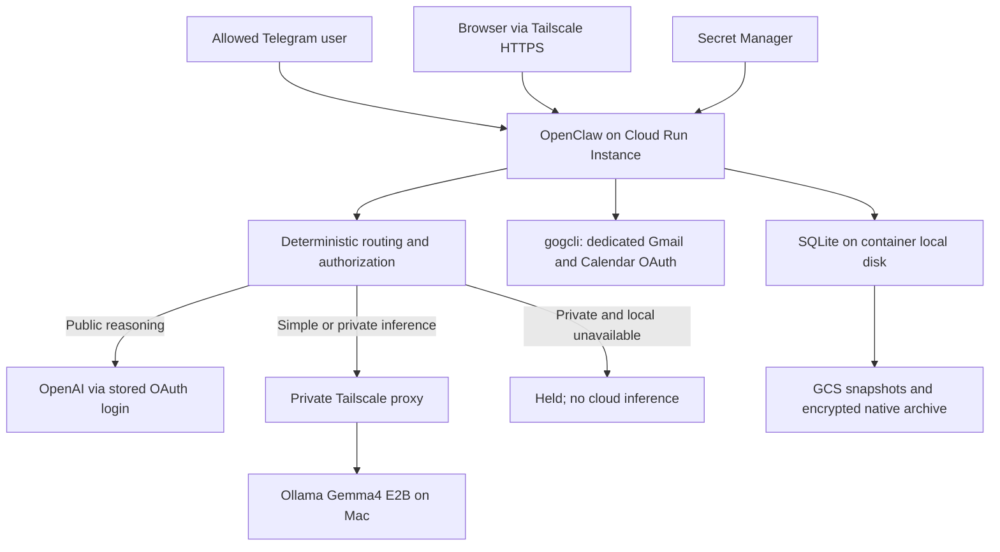

# PDF re-audit, deployment explanation, and revised demonstration plan

Update after this audit: see [USC Edu and persistent heartbeat correction](../operations/HEARTBEAT_EDU_FIX.md). The account and heartbeat findings below describe the audit-time state; subsequent fixes are recorded separately. Grader access remains assigned to the student.

Checked November 17, 2026. **Do not treat the submission as fully ready yet.** The implementation has substantial working evidence, including approved email sending, but the current OpenAI entitlement, grader access, and persistent heartbeat configuration need attention. This document supersedes broad readiness statements and the older remaining-acceptance list. Historical reports and failed evidence remain intact.

## What was reviewed

All 13 supplied PDFs were reread end-to-end as page-marked extracted text: 357 pages. The manifest is [reading-manifest.json](../../evidence/pdf-reaudit/reading-manifest.json). This is a text-content review, not an independent visual validation of every diagram or screenshot.

The Assignment Description sets the rubric; the video and local-Gemma supplements add demonstration/handoff instructions. Setup Recommendations explicitly adds no requirements. Deployment Reference is optional infrastructure guidance. Lectures 15–22 supply architectural, security, measurement, protocol, computer-use and orchestration context; they do not require implementing every illustrated SDK, benchmark, browser agent, MCP server or multi-agent loop.

## Requirement-to-evidence assessment

| Requirement and PDF reference                                                          | Evidence / current assessment                                                                                                                                            | Remaining action                                                                                                                                                                                                  |
| -------------------------------------------------------------------------------------- | ------------------------------------------------------------------------------------------------------------------------------------------------------------------------ | ----------------------------------------------------------------------------------------------------------------------------------------------------------------------------------------------------------------- |
| Permitted cloud provider: Description p2, p6                                           | Actual Luna inference exists through OpenClaw OAuth. **Current saved token says `free`, dedicated Gmail identity, not verified USC Edu.**                                | Resolve entitlement against the stated USC ChatGPT Edu path, or use the permitted NVIDIA NIM path. A working model alone does not close this requirement.                                                         |
| Local Gemma through Ollama/Tailscale: p2, p7                                           | Gemma4 E2B, private proxy, deployed-agent inference and served-model logs recorded.                                                                                      | Fresh final preflight and required four-request video. Show actual served context, not only configured maximum.                                                                                                   |
| Intelligent hybrid routing: p7–8, p19                                                  | `ROUTING_FIX_STATUS.md`: simple/local, reasoning/cloud, private outage/held, recovery/local, public outage/cloud, simulated cloud limit/local.                           | Retest affected routes after any authentication/config changes; preserve OPS-ROUTING-001.                                                                                                                         |
| Four skills: p2, p20                                                                   | Calendar, email, web search and to-do have code and human rehearsal evidence under `evidence/telegram-fix/rehearsal-*`.                                                  | Keep all four verifiable in deployment; include email approval in demonstration. Do not confuse direct report commands with model-generated tool calls.                                                           |
| Every email send human-approved and allowlisted: p3–4                                  | Implemented authenticated Telegram commands, payload digest, expiry, single-use outbox. Actual approved send and independent Gmail Sent verification; duplicate blocked. | Fresh draft/source for another live send; old SENT approval cannot be reused.                                                                                                                                     |
| At least four advanced features: p3–4, p19                                             | Briefing, recap, email intelligence, alerts and learned knowledge have positive evidence. Calendar conflict/slot logic exists.                                           | Do not advertise all six as fully demonstrated: tagged meeting-context demonstration remains pending in the acceptance record. Report usefulness/quality still matters.                                           |
| Required proactive video: p16                                                          | Prior scheduled briefing/recap/reminder deliveries exist.                                                                                                                | Record actual scheduled arrivals in final video; label accelerated morning/evening timing. A manual `/briefing` is only a rehearsal preview.                                                                      |
| Container plus another security measure: p2–3, p19                                     | Live UID1000, zero effective capabilities, no-new-privileges; tool/Telegram/recipient restrictions; Secret Manager.                                                      | Document remaining operator/plugin trust boundary and dependency findings.                                                                                                                                        |
| Five-risk audit and three attacks if claiming injection defense: p16, p19              | Security report contains ten risks and three deployed attacks with state checks; separate mocked inbox tests.                                                            | Preserve detector failure and dependency warnings. Do not call this a live Gmail/HTML-attachment audit or universal protection.                                                                                   |
| Persistent personalized memory, GCS and restart recovery: p3, p12–14, p20              | Local transactional SQLite, GCS snapshots, encrypted native-state archive; authenticated Atlas task/fact recovered after replacement.                                    | Explain recovery evidence and known background writers. Persistent heartbeat correction is still needed.                                                                                                          |
| >=48-hour operation: p3, p14, p16                                                      | Nov13 08:30:39.916Z–Nov15 08:30:39.916Z, 2,864 reconciled samples; scheduled delivery; original routing incident retained.                                               | Submit original window plus separately dated corrections. PDFs do not explicitly require restarting the entire window solely for that routing defect; do not claim final code ran unchanged for those 48 hours.   |
| Comparative evaluation >=3 task types: p16, p19                                        | 60 original attempts plus 12 separate recovery checks; raw outputs, correctness, latency, identities, cost caveats.                                                      | Add explicit context/thinking settings to final report; do not present OAuth catalog estimates as billed cost or this small benchmark as general model quality.                                                   |
| Original advanced integration: p20                                                     | Published `@aniruth1011/assistant-todo-triage@1.0.0`; fresh registry installation, OpenClaw discovery and installed helper execution.                                    | Include public link, pinned version and transcript. Evidence does not claim autonomous LLM skill selection.                                                                                                       |
| Grader access: local-Gemma pp16–20,28–29                                               | Owner dashboard works, but live config has `allowTailscale:false`, token auth.                                                                                           | Implement and verify the supplement's Tailscale identity path, persistent identity, restricted443 sharing and reusable agent-machine invitation. Fresh grader-like browser must work without owner pairing/token. |
| Source, README, personalization, process log, MP4/private handoff: Description pp16–18 | Source and reports exist; several status documents are stale.                                                                                                            | Reconcile final docs, student learning reflection, allowlisted ZIP, inspect final MP4, private Brightspace access handoff.                                                                                        |

Full-inbox sender search, an arbitrary “16 checks” suite, zero weather failures, three messaging services and A2A are not all compulsory. Three services and A2A are alternatives to the publication option. Weather is required for the claimed briefing; Open-Meteo specifically is not mandatory. Existing limited inbox behavior must be disclosed rather than described as full-mailbox search.

## What is deployed, and why it works without you entering keys each time

Live sanitized inspection: [deployment-auth-sanitized.json](../../evidence/pdf-reaudit/deployment-auth-sanitized.json).



- **Cloud host:** Cloud Run **Instance** `applypilot-gate9`, region `us-west1`, project `amplified-coder-510723-p3`. It runs the gateway, router, tools, scheduler and persistence. The Mac runs local inference. Closing the Mac removes Gemma availability, not the cloud host.
- **Runtime:** OpenClaw2026.11.2, Node24.22.1; immutable image digest `bb67eb5a42942b44e8a2f28871a70673a05b4549b307310fb03bbbd98adcb1b5`. Allocation is **2 vCPU/4GiB**, not the PDF's starting recommendation. Explain the larger allocation using actual resource observations; DEV_LOG recorded gateway RSS around1.4GiB during recovery, not a measured4GiB requirement or proven OOM.
- **Cloud model login:** live public-research profile is OAuth, with access and refresh tokens, no API key. Gateway process has no `OPENAI_API_KEY` environment variable. DEV_LOG records supported browser OAuth renewal on Nov16 around20:31UTC. The browser sign-in authorized the platform; you did not need to paste a paid API key. This is separate from this Codex coding conversation.
- **Important entitlement gap:** current token metadata identifies `agentai599@gmail.com` with plan type `free`. Do not narrate this as USC ChatGPT Edu. Metadata is not an independent billing/account audit, but it provides no evidence of the required Edu entitlement. Verify the intended workspace through supported sign-in, then verify a real served-model receipt. A USC ChatGPT login does not authorize connecting a USC mailbox; mail/calendar must stay synthetic.
- **Google application credentials:** a Desktop OAuth client ID and client secret already exist in the bootstrap Secret Manager bundle. Its project is `job-application-514306`, different from the hosting project. The live gog client ID matches the bootstrap client. DEV_LOG records importing a downloaded OAuth JSON and browser consent on Nov10, then Calendar scope/API setup. I can verify this history and current storage, not independently identify who originally created the client.
- **Google user authorization:** the dedicated account has `gmail.readonly`, `gmail.send`, `calendar.readonly` and identity scopes. The client identifies the app; the account's OAuth grant authorizes data access. The refresh token allows renewed short-lived access without a new sign-in for every read. Revocation/expiry can still require browser consent again.
- **Google storage:** gog uses an encrypted file keyring, with its password supplied by Secret Manager. Runtime bootstrap imports credentials and removes temporary client/token files. Native state is restored from an encrypted archive. These credentials are not supplied by the language model.
- **Cloud runtime identity:** `applypilot-runtime@amplified-coder-510723-p3.iam.gserviceaccount.com` is the hosting service account. It is distinct from Google mailbox OAuth and the operator's `gcloud auth login`. It does not, by itself, grant Gmail access.
- **Other credentials:** Telegram bot token identifies the bot; the user allowlist restricts senders. Gateway token authenticates the dashboard/operator. Tailscale credentials connect machines. These are separate purposes; never display them in the video or ZIP.
- **Persistence:** active SQLite is on local transactional storage, not GCS FUSE. Consistent snapshots and encrypted native archives go to GCS and restore on boot. A bucket is used without needing a live SQLite bucket mount.

## Email: exact behavior and evidence

This implementation sends only to the dedicated test mailbox itself. It is not an arbitrary-recipient mail client.

1. `/emaildigest` reads synthetic email and shows summaries, urgency and eligible review commands.
2. `/reviewemail THREAD_ID` reads the source, creates/retrieves a draft and displays recipient, subject, body, expiry and the exact approval command. **Review does not send.**
3. The authenticated human inspects that payload and submits the displayed `/approveemail DRAFT_ID DIGEST`.
4. Deterministic code verifies actor, recipient, exact payload digest, expiry and single-use state, then invokes Gmail. Scheduled jobs cannot supply this approval.
5. `/emailstatus DRAFT_ID` shows durable status. Gmail Sent-folder verification checks the actual provider effect. Resending an already-used approval is blocked.

Existing actual send: `email-1fd0351c5c1dc9a8f806db99`, approved2026-11-17T00:29:25.650Z. Provider message `1a1e6e89c1fb52a6` matched recipient, subject, body and Sent label; exactly one sending event. Evidence: `rehearsal-email-send-confirmed.json` and `rehearsal-email-duplicate-blocked.json` in `evidence/telegram-fix`.

The mandatory five video scenes do not separately demand a new outgoing email. Nevertheless, showing review→human approval→actual Sent is valuable and included below. Never reuse the old SENT source/digest and expect another send. A fresh eligible synthetic message and actual generated review command must be prepared first; no invented IDs or approvals.

## Work order before another final recording

1. **Resolve cloud entitlement.** Inspect supported account/workspace selection with the user; configure USC Edu OAuth or permitted NIM, verify actual inference and scheduled account binding, then repeat affected route checks. Requires the account owner's sign-in if changing credentials.
2. **Close grader access.** Correct both source startup behavior and effective config: startup currently forces Tailscale auth off, so changing only a live checkbox will not persist. Verify HTTPS identity, socket/Serve configuration, restricted access and stable machine identity across restart. Create the reusable share invitation privately near submission. An authenticated owner test is insufficient.
3. **Persist heartbeat mitigation.** The supported runtime switch stopped the unwanted background replies; it does not survive restart. Validate a supported persistent heartbeat setting for the pinned release, keep scheduled report jobs, and verify after restart that the refusal echo does not return. Inspect memory-flush/dreaming writers separately.
4. **Reconcile quality and evidence.** Keep at least four substantiated advanced features; either demonstrate tagged meeting context or narrow that claim. Describe bounded email scans, extractive summaries, weather fallback and unresolved security findings. Verify no expired dates/empty test data make the final demonstration misleading.
5. **Prepare the fresh email approval demonstration.** Use a new synthetic source in the dedicated mailbox, read and inspect the draft, record the current thread ID privately in the rehearsal checklist. A human must approve the exact outgoing payload. If the draft is unclear, stop and correct the source; do not bypass `EMAIL_CONTEXT_NEEDS_HUMAN`.
6. **Run affected checks and a complete rehearsal.** Formatting/typecheck/lint/unit and relevant integration tests for code changes; actual cloud/local/provider/access/restart checks for deployment changes. Preserve failed attempts. Do not equate compilation with deployment success.
7. **Then arm a new recording schedule.** The old10:35 schedule is historical. Do not wait for its elapsed times or copy them into a new plan. Use the relative scheduler only after the above checks pass.
8. **Package.** Update README, security/performance reports, personalization and process disclosure; student writes their own understanding/reflection. Exclude `.runtime`, secrets, raw native databases and credential files. Include selected sanitized evidence and original48-hour provenance. Verify ZIP contents, MP4 and private handoff separately.

No code, deployment or authentication changes were made by this re-audit. No new email was sent. The steps above are remaining work, not completed fixes.

## Complete rehearsal before the timed take

Use the existing allowed Telegram account in **Telegram Desktop**, not a phone that Zoom cannot capture.

| Action                                                                                                                                                                                | What to verify                                              | Suggested spoken explanation                                                   |
| ------------------------------------------------------------------------------------------------------------------------------------------------------------------------------------- | ----------------------------------------------------------- | ------------------------------------------------------------------------------ |
| Send `Hi, what can you do?`                                                                                                                                                           | A fresh coherent reply, no repeated historical send refusal | “Telegram is the assistant's everyday interface.”                              |
| Send `/emaildigest`                                                                                                                                                                   | Current synthetic summaries, urgency, review command        | “It reads the dedicated test mailbox and prepares replies for review.”         |
| Send the displayed `/reviewemail THREAD_ID`                                                                                                                                           | Fresh DRAFT, exact recipient/body/expiry                    | “This is a proposal. Nothing has been sent.”                                   |
| Inspect payload, then send its exact `/approveemail DRAFT_ID DIGEST`                                                                                                                  | SENT; verify matching message in dedicated Gmail Sent       | “I explicitly approve this recipient and content. Code enforces the approval.” |
| Repeat that exact approval once                                                                                                                                                       | Already-attempted refusal and no second send                | “The approval is single-use, so retrying cannot send a duplicate.”             |
| Send `/calendarcheck`                                                                                                                                                                 | Dedicated calendar, conflicts/gaps and valid slots          | “Calendar access is read-only; these are suggestions, not bookings.”           |
| Send `Analyze public web search results for this query: "official OpenClaw docs". Call web_search with that query and return source links. Do not use skills_search as a substitute.` | Actual web_search results/links in isolated public route    | “Only this explicit public query goes to the public research session.”         |
| Send `/todoadd none 2 Prepare synthetic recording notes [duration:15m]`                                                                                                               | Returned task ID; same command reuses task                  | “The fourth skill is a persistent to-do list with duplicate protection.”       |
| Send `/todos`, then `/tododone RETURNED_TASK_ID`, then `/todos completed`                                                                                                             | The same task completed once                                | “Authenticated commands control changes; a model cannot authorize them.”       |
| Send `/remember style communication concise`, then `/knowledge`                                                                                                                       | Saved preference and revision                               | “Fictional preferences are stored and mirrored into the workspace.”            |
| Send `/briefing` and `/recap`                                                                                                                                                         | Preview current useful content                              | “These are manual previews. The recording will show scheduled delivery.”       |

`THREAD_ID`, `DRAFT_ID`, `DIGEST` and `RETURNED_TASK_ID` mean copy the exact value returned by the assistant; they are not literal text to send. The scheduled video deadline task is separate: leave it open so its reminder still fires. Restart-recovery is a separate pre-recording test; do not restart the cloud instance during the video.

## Recording links and setup

- Dashboard: https://applypilot-cloud.tail631b8f.ts.net/
- Telegram bot: https://t.me/Apply599bot
- USC Zoom: https://usc.zoom.us
- Published skill: https://clawhub.ai/aniruth1011/skills/assistant-todo-triage
- GCP console: https://console.cloud.google.com/?project=amplified-coder-510723-p3
- Tailscale machines: https://login.tailscale.com/admin/machines
- Tailscale access controls: https://login.tailscale.com/admin/acls
- Dedicated Gmail: https://mail.google.com/ — confirm `agentai599@gmail.com` before showing data.

Complete sign-in/pairing before sharing the screen. Never record a gateway token, OAuth callback, Secret Manager value or private Tailscale invite. Show the **Hardware UUID**, not the network MAC address. Audio is explicitly optional (Video Instructions p1); the narration below is provided because requested.

Open Terminal in the assignment folder. Prepare System Information → Hardware → Hardware Overview, Telegram Desktop, the dashboard and the safe version/log commands. Keep the Mac awake and plugged in. Run:

```sh
caffeinate -dims
```

Leave that terminal running. In another terminal, from the repository root:

```sh
brew services start ollama
ollama list
/Applications/Tailscale.app/Contents/MacOS/Tailscale serve status
node scripts/operations/show-deployed-version.mjs
node scripts/operations/show-video-routes.mjs
```

Once remaining blockers are closed and rehearsal passes, run:

```sh
node scripts/operations/video-demo.mjs status
node scripts/operations/video-demo.mjs arm
```

Start Zoom recording at the printed start time only if the helper prints READY. It schedules briefing at+1minute, saved-task reminder at+4minutes30seconds, recap at+6minutes. Provider execution/delivery may take longer. Its READY checks do **not** certify cloud entitlement, grader access or every rubric item.

## Recording sequence and words to speak

Main Description p16 says5–7minutes; local-Gemma p23 estimates7–10. Target approximately7minutes while retaining required scenes. Extra narration/email verification must fit the measured rehearsal; do not silently omit mandated routing or proactive scenes to meet time. If the complete required take cannot fit, obtain course clarification on the duration discrepancy. Do not represent a manually triggered report as scheduled.

1. **Hardware first.** Show Hardware UUID in System Information. Say: “This is the Mac running my local Gemma model.”
2. **Actual deployed runtime.** Show output of `node scripts/operations/show-deployed-version.mjs`. Say: “The assistant runs on a Google Cloud Run Instance with OpenClaw2026.11.2. The Mac supplies local inference over private Tailscale.”
3. **Local service.** Run `ollama list` and the Tailscale Serve status command above. Say: “Gemma4 E2B is available through Ollama. Port11434 is forwarded privately to its loopback listener.”
4. **Scheduled briefing.** At approximately+1minute, show the actual Telegram arrival, including calendar, weather and email summaries. Say: “This scheduled briefing uses the dedicated test accounts. I accelerated the demonstration time; it normally runs in the morning.” Name Open-Meteo or NWS only if that output actually names it. If unavailable, acknowledge it.
5. **Local route.** Open a fresh dashboard chat under Researcher (`public-research`); leave automatic/default routing. Send `What is 12 times 9?` Wait for108. Say: “This simple public task is routed locally.”
6. **Cloud route.** In another fresh Researcher chat send `Explain step by step why the sky is blue.` Wait for the full answer. Say: “The reasoning rule selects the cloud model. The log will show the model that actually served it.” Use the final verified cloud model name, not an assumed Luna label after any provider change.
7. **Local outage.** Run `brew services stop ollama`, then `curl -s -m 3 http://127.0.0.1:11434/api/tags || echo "Ollama is off"`. Wait for availability detection. In a fresh **main/private** dashboard chat send `This is confidential: remind me my locker code is on a sticky note.` Show held/unavailable result. Say: “My policy holds private requests when local inference is unavailable; it does not send them to the cloud.”
8. **Recovery.** Run `brew services start ollama`, then `ollama list`. After recovery, in main/private send `This is confidential: say "back online" in three words.` Wait for the actual reply. Say: “Local inference has recovered.” Do not claim three-word compliance if it returns different wording.
9. **Proof.** Run `node scripts/operations/show-video-routes.mjs --video`, then immediately `ollama ps`. Show matching timestamps/request IDs, local→cloud→held→local decisions, actual served identities and successful outcomes. Say: “These are recorded decisions and completed model calls. The held request has no successful model call. Gemma is loaded on this Mac.”
10. **Messaging.** In Telegram Desktop send `Hi, what can you do?` and show the actual reply. Say: “This is a live interaction through Telegram.”
11. **Email approval.** With a fresh eligible source prepared, send its `/reviewemail` command. Show recipient/body. Say: “Reviewing a draft does not send it.” Inspect and submit the exact displayed approval. Show SENT and matching dedicated Gmail Sent message. Say: “Only my authenticated, payload-specific approval permits sending.” If timing permits, replay approval once to show duplicate blocking. Existing recorded send evidence can support the report, but is not a new live send.
12. **Proactive reminder.** Show the message scheduled at+4minutes30seconds, even if it arrived while routing was being demonstrated. Say: “This reminder reads an actual saved open task. It was delivered without a new chat request.” It is a one-time scheduled reminder, not proof of newly detected inbox activity.
13. **Recap.** Show the scheduled recap at+6minutes after actual arrival. Say: “This uses simulated evening timing and reports actual recorded activity, review items and tomorrow's plan.” Do not say it includes a send that finished after its data snapshot.
14. **Evidence and publication, if time permits.** Briefly show the published skill version and report index. Say: “The submission includes the original48-hour logs and routing incident, a three-task-type comparison, security attacks with residual findings, and fresh-install evidence for my published to-do skill.”
15. Stop Zoom and end the meeting. Watch the entire converted MP4. Confirm every required scene, readable results, actual delivery and no secrets. Rename `Assignment3-CSCI599-USCusername.mp4`, substituting the USC login name. Submit the source ZIP and private grader handoff separately as instructed.

For a failed take, `node scripts/operations/video-demo.mjs cancel` pauses only the three recording jobs. Inspect the cause before rearming. Never delete original48-hour logs or relabel failed attempts as successful evidence.

## Short deployment explanation to learn

“OpenClaw runs continuously in a Cloud Run Instance. Telegram and the browser connect to that cloud gateway. A deterministic router selects local Gemma for simple or private requests and the cloud model for public reasoning. Local calls travel through Tailscale to Ollama on my Mac. Private requests are held if the Mac is unavailable. Google integrations use a previously authorized dedicated test account; OAuth credentials are securely stored and refreshed. Email sending additionally requires my authenticated approval for the exact payload. SQLite handles transactional state locally, and GCS snapshots restore it after restart.”

For the model login, use only after the entitlement is resolved: “The cloud model uses the platform's supported OAuth login, not an API key pasted into my source code.” Add “USC ChatGPT Edu” only once that workspace is actually verified. Never describe all provider usage as free: actual billing/allowance was not measured.
